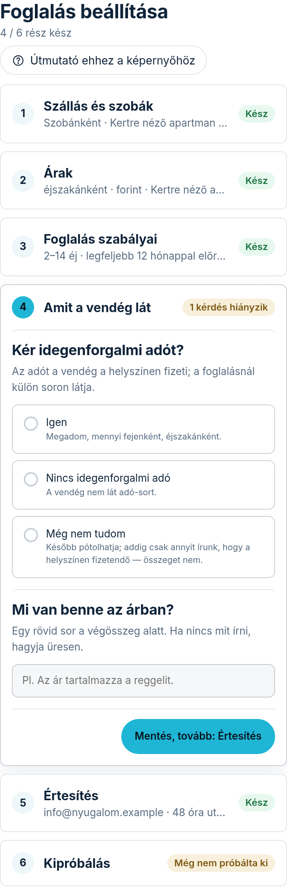
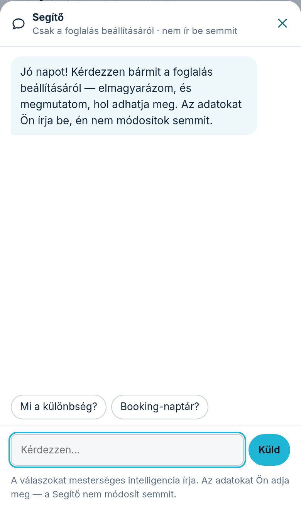

Ezen az egy oldalon mindent beállít, ami ahhoz kell, hogy a vendégek foglalhassanak: a szobákat,
az árakat, az időszakokat és a foglalás szabályait. Nem kell tudnia, melyik menüben mi van — az
oldal kérdez, Ön válaszol. Ha valamit nem ért, a **„Segítő”** elmagyarázza.

Így éri el: a **Modulok** fülön nyissa meg az Online foglalás képernyőjét. A naptár és a kérések
alatt áll a **„Foglalás beállítása”** kártya — a **„Beállítom kérdésről kérdésre”** gomb nyitja
meg ezt az oldalt. Ha az Online foglalás modul nincs bekapcsolva, az oldal nem nyílik meg.

## Hogyan halad végig?

Az oldal hat részből áll, ebben a sorrendben: **„Szállás és szobák”**, **„Árak”**,
**„Foglalás szabályai”**, **„Amit a vendég lát”**, **„Értesítés”** és **„Kipróbálás”**.
Minden rész mellett egy címke mondja meg, hol tart: **„Kész”**, **„Még nincs kitöltve”**,
vagy hogy hány kérdés hiányzik, illetve hány akadály van benne. A **„Kipróbálás”** rész címkéje
**„Még nem próbálta ki”**, amíg ezen az oldalon nem futott egy próba-foglalás — megnyitva a rész
magától kipróbál egyet. A cím alatt az is látszik, hány rész kész a hatból.

1. Koppintson egy részre: kinyílik, és látja a kérdéseit. Egyszerre egy rész van nyitva.
2. Válaszoljon a kérdésekre. A becsukott részeknél a válaszai egy sorban látszanak, így később
   ránézésre látja, mit állított be.
3. A rész alján a **„Mentés, tovább”** gomb elmenti a választ, és kinyitja a következő részt.
   Ha közben másik részre koppint, az addig beírtakat akkor is elmentjük.
4. Ha valami nem jó (például a legrövidebb foglalás hosszabb a leghosszabbnál), a gomb fölött
   piros sor mondja meg, mit javítson — ilyenkor semmi nem változik.

Ugyanez az oldal való a későbbi módosításra is: ha egy év múlva emelné az árat, ugyanitt teszi meg.

## Szállás és szobák

Először azt kérdezzük, hogyan adja ki a szállását: **„Egyben, egy egységként”** (az egész ház
egyszerre egy vendégkörnek) vagy **„Szobánként”**. Szobánként a vendég egy kérésben egy vagy
több szobát foglalhat, akár mindet: aki az egész házat szeretné, minden szobát kijelöl, és a
szobák árát fizeti — az egész háznak ezért nem kell külön árat adnia. A több szobás kérést Ön
egyben igazolja vissza vagy utasítja el a Foglalások fülön.
Ha csak egyben adja ki, de a szobáit be szeretné mutatni, az elsőt válassza: akkor csak az egész
ház foglalható, és árat is csak a házra kérünk.

Utána a szobák nevét és a férőhelyet adja meg; az **„+ Újabb szoba”** gombbal vehet fel újat.
A férőhely a foglalás felső határa is: a vendég ennél több főt nem adhat meg, és a rendszer
többre nem fogad el kérést („Ide legfeljebb 4 vendég foglalhat.”). Ahol üresen hagyja, ott nincs korlát.
Szobát törölni itt nem lehet: azt a **„Szobák”** képernyőn teheti meg, mert ott látja, mi
tűnik el vele (naptár, árak, korábbi foglalások).

## Árak és időszakok

- Először azt választja ki, mire szól az ár: **„Éjszakánként”**, **„Fejenként, éjszakánként”**
  vagy **„A teljes tartózkodásra”**.
- Aztán szobánként az alapárat. Ha nem akar árat megadni, pipálja be a **„Nem adok meg árat — a
  vendég ajánlatot kér, és én küldök árat”** sort.
- Más árú időszakot (például főszezont) az **„+ Új időszak”** sorral vesz fel: név, kezdő és záró
  nap (hónap-nap, például 06-15), ár, és ha kell, hogy legalább hány éjszakára lehet foglalni.
  A **„Hozzáadom”** gomb azonnal elmenti; több szobánál a **„Minden szobához hozzáadom”** gomb
  mindegyikhez felveszi.
- Ha van időszaka, azt is megkérdezzük, hogy az időszakokon kívül is kiadja-e.

Évhez kötött árat és az időszakok sorrendjét az **„Árak és időszakok”** képernyőn adhatja meg.

## Foglalás szabályai

- **Hány éjszakára lehet foglalni?** — a legrövidebb (1–30) és a leghosszabb (1–365) foglalás. Ha egy
  időszakhoz külön „legalább” értéket adott, abban az időszakban az érvényes.
- **Mennyivel előre lehet foglalni?** — hány hónapra előre nyílik a naptár (1–24), és legkorábban hány
  nap múlva érkezhet a vendég (0 = akár mára is).

## Amit a vendég lát

- **Kér idegenforgalmi adót?** — három válasz van. **„Igen”**: beírja az összeget (Ft / fő / éj), és a
  vendég külön soron, kiszámolva látja. **„Nincs idegenforgalmi adó”**: a honlapja nem is említi.
  **„Még nem tudom”**: a vendég csak annyit lát, hogy a helyszínen adó fizetendő, összeget nem —
  számot nem találunk ki Ön helyett. Az adót a vendég a helyszínen fizeti, a végösszegbe nem számoljuk.
  A 18 év alatti vendég mentes az adó alól: a foglalásnál a vendég mindig megadja, hányan gyermekek
  („Ebből gyermek”), azokra nem számoljuk, és ezt egy mondat ki is mondja a vendégnek.
- **Mi van benne az árban?** — egy rövid sor a végösszeg alatt (például: takarítás, ágynemű, reggeli).
  Nem kötelező; üresen hagyva ez a sor elmarad.

## Értesítés

- **Hová küldjük a foglalási kéréseket?** — ide megy minden kérés e-mailben; több címet vesszővel
  adhat meg. Üresen hagyva a fiókja címére küldjük. Ha egy cím nem e-mail cím, az oldal szól, és nem ment.
- Alatta azt adja meg, hány óra után járjon le magától a kérés, ha nem válaszol. Ilyenkor a vendég
  értesítést kap, hogy máshol keressen szállást. 0 = a kérés soha nem jár le.

## Ha akadályt jelez az oldal

A **„Kipróbálás”** részben az oldal kiírja azokat a beállításokat, amelyek miatt a vendég nem, vagy nem
jól tud foglalni. A **sárga** doboz miatt a vendég NEM tud foglalni — például ha egy szobát csak az
időszakokban ad ki, de nincs időszaka, vagy ha egy időszakban több éjszaka a minimum, mint a
leghosszabb foglalás. Ilyenkor az érintett rész mellett piros címke mondja, hány akadály van benne.
A **szürke** doboz csak figyelmeztet: például egy szobának nincs ára, ezért a vendég végösszeg nélkül
küld kérést, és Ön válaszol árajánlattal. A doboz mellett a **„Javítom”** gomb odaviszi a kérdéshez.

Az oldal alján a **„Kész — a vendégek foglalhatnak”** gomb addig nem nyomható, amíg sárga akadály
van, vagy egy kötelező kérdés még nincs megválaszolva. Ha nyomható, az Online foglalás képernyőjére visz.

## Kipróbálás

Adjon meg egy kitalált foglalást: szobát, érkezést, éjszakák és vendégek számát, és azt, hogy
**„Ebből gyermek”** hány fő. Ha ellátást is kínál, az **„Ellátás”** mezővel a felárat is kipróbálhatja.
Az oldal megmutatja, amit a vendég látna: a szállás árát, az ellátás sorait és az összeget, az
idegenforgalmi adót, vagy azt, hogy miért nem tudná elküldeni. Ugyanazt a szabályt használja, mint a honlapja foglalási űrlapja.
Ez csak próba: semmit nem küldünk el, és nem foglal le napot.

## A Segítő

Telefonon az oldal alján a **„Kérdezzen a Segítőtől”** sáv nyitja meg; számítógépen a
Segítő az oldal jobb oldalán áll. Írja be a kérdését, vagy koppintson egy javasolt kérdésre.

- A Segítő **elmagyarázza** a beállításokat, és ha kell, egy gombbal **odaviszi** a kérdéshez,
  ahol megadhatja.
- **Semmit nem ír be és nem módosít** — a döntés és a beírás az Öné.
- Csak a foglalás beállításáról beszél. Más kérdéssel a Súgót vagy minket keressen.
- A válaszokat mesterséges intelligencia írja. Ha valami nem egyezik azzal, amit a képernyőn lát,
  a képernyőnek higgyen.
- Naponta legfeljebb 40 kérdést válaszol meg; utána másnap folytathatja.

## Haladó beállítások

Az oldal tetején a **„Haladó beállítások”** linkkel a korábbi képernyők nyílnak meg: **„Szobák”**
(fotók, leírás, felszereltség, szoba törlése), **„Árak és időszakok”** (itt adja meg az ellátást —
reggeli, félpanzió — a felárakat és a gyerekárat is) és **„Online foglalás”**
(naptár, más oldalak naptára és a korábbi beállító űrlap). Ugyanazokat az adatokat látják, mint ez
az oldal — ha ott módosít valamit, itt is az látszik.
