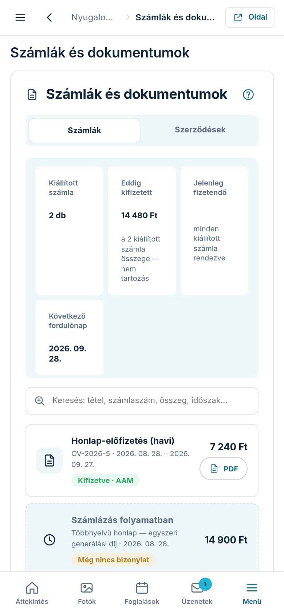

A **„Dokumentumok”** fülön egy helyen áll minden bizonylata: a számlái és azok a
nyilatkozatok, amelyeket a megrendeléskor elfogadott.

## A két lista

A fül tetején két gomb választja szét a kétféle iratot:

- **„Számlák”** — a rólunk kiállított számlák, letölthető PDF-fel.
- **„Szerződések”** — amihez hozzájárult: a megrendelés adatai, az Általános Szerződési
  Feltételek elfogadása és a fotó-jogi nyilatkozata.

## A számlák listája

A lista tetején egy halvány dobozban legfeljebb négy adat összegez:

- **„Kiállított számla”** — hány számla készült (a szűrésnek megfelelően).
- **„Eddig kifizetett”** — ezek együttes összege. Ez **nem tartozás**: a már kifizetett
  számlák összege, ezért a cella alatt ki is írjuk, hogy „nem tartozás”.
- **„Jelenleg fizetendő”** — amit MOST kell rendeznie. Ha minden számla ki van fizetve,
  0 Ft áll itt és alatta „minden kiállított számla rendezve”. Ha nem nulla, a honlapja
  emiatt felfüggesztésre kerülhet — ezt rendezze először. (Csak előfizetés mellett látszik.)
- **„Következő fordulónap”** — mikor esedékes a következő díj.

Fontos: ha évre szűr, a számla-darabszám és az „Eddig kifizetett” összeg az adott évre
vált (az első cella címe ilyenkor az évet mondja). Így pontosan azt látja, amit a
könyvelőnek meg kell adnia. A „Jelenleg fizetendő” és a fordulónap a szűréstől független.

## Mit lát egy soron

A sor **legfelső, vastag sora azt mondja meg, MIRŐL szól a számla** — például
**„Honlap-előfizetés”** (mögötte zárójelben a fizetési ütem: éves vagy havi) vagy
**„Többnyelvű honlap — egyszeri generálási díj”**. Alatta halványan a **számlaszám** áll, és
mellette a **számla dátuma**; megújításkor pedig **az az időszak, amit a számla fedez**
(például „2026. 08. 28. – 2026. 09. 27.”). A jobb szélen az összeg.

Ez azért így épül fel, mert sok számlája hasonló összegű lehet, és a puszta számlaszámból
nem derülne ki, melyik mire szólt. A tétel nevével egy pillantással kiválasztja a keresettet.

## A számla letöltése

Minden soron van egy **„PDF”** gomb — egy koppintás, és letöltődik a számla.
Ezt küldheti tovább a könyvelőjének.

Ha egy soron **„Számlázás folyamatban”** felirat áll a **„Még nincs bizonylat”** címkével,
az azt jelenti, hogy a számla kiállítása még tart. Ilyenkor a tétel neve a felirat alatti
halvány sorban áll, mert ennek a sornak még nincs számlaszáma. Ez nem hiba és nem az Ön teendője:
amint elkészül, itt megjelenik, és e-mailben is megküldjük.

## Keresés és szűrés

A kereső mezőbe beírhatja a **tétel nevét** (például „többnyelvű”), a **számlaszámot**, az
**összeget** vagy az **időszakot** — a lista azonnal szűkül. Ékezet nélkül is talál: a
„szamla” megtalálja a „számlá”-t. Mellette évszám-gombok állnak; ezek mindig csak azokat az éveket
kínálják, amelyekhez tényleg tartozik irat.

Ha szűrt, megjelenik a **„Szűrés törlése”** link, amivel visszakapja a teljes listát.

Ha a keresésnek a másik listában is van találata, a felület ezt kiírja a találatszám
mellett, és egy koppintással átvisz oda. Nem kell kétszer rákeresnie ugyanarra.

## Szerződések

Ezeket a bejegyzéseket nem lehet módosítani — épp az a szerepük, hogy megőrizzék, mihez
és mikor járult hozzá. Ahol a szöveget is eltároltuk, ott szó szerint elolvashatja, amit
elfogadott.
