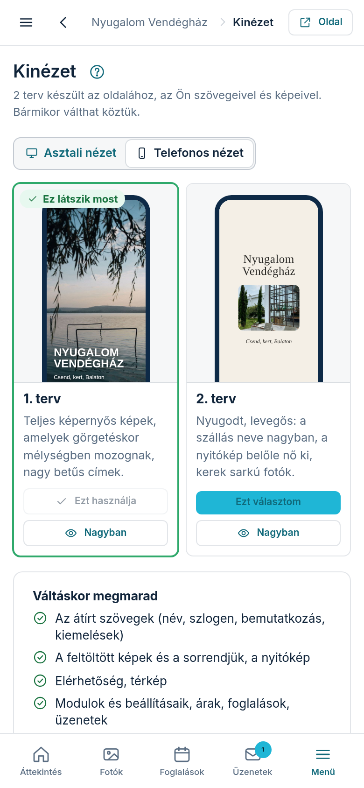
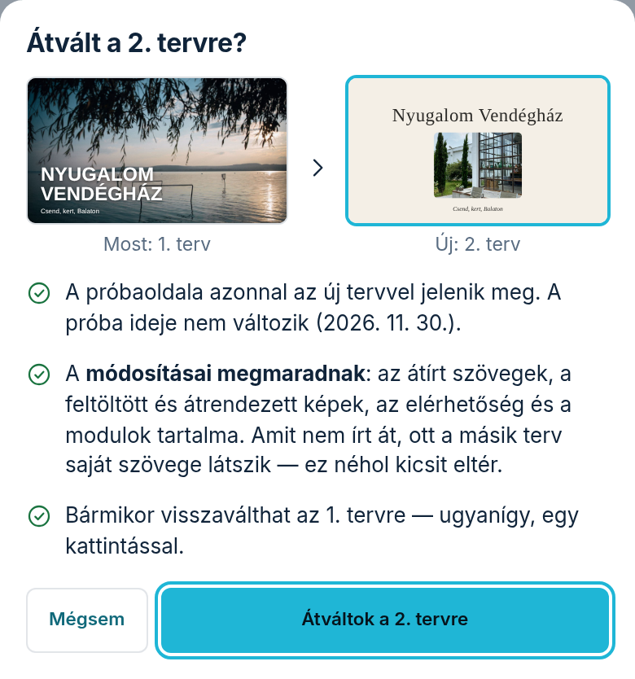

A honlapjához több **terv** is készülhetett: ugyanazokkal a szövegekkel és képekkel, de más elrendezéssel,
betűkkel és színekkel. Ezeket látta a linken, amit tőlünk kapott („1. terv”, „2. terv”). A **Kinézet**
menüpontban (az „Az oldalam” csoport első sora) bármikor átválthat egy másik tervre, és ugyanígy vissza is.
A próba alatt és megrendelés után is működik, és maga a váltás nem kerül semmibe.

A képen az előnézetek egyszerűsített minták; a valóságban a kártyán a terv teljes oldala látszik.

Ha az oldala még nem készült el, a lap ezt írja ki: **„A kinézet akkor választható, ha a honlapja már elkészült.”**

## Hol találja

- Számítógépen a bal oldali menüben, a **Kinézet** sorban. Ha több terv készült, mellette látja, melyik
  fut most (például „1. terv”).
- Telefonon a lap alján a **„Menü”** gombbal nyílik a teljes menü, abban van a **Kinézet**.
- Ha több terv készült, az **Áttekintés** nyitókép-kártyáján a **„Másik terv”** gomb ugyanide visz.

Ha az oldalához csak egy terv készült, a lap ezt írja ki, és nincs mire váltani.

## A tervek megtekintése

1. Minden terv egy kártya, rajta egy kis előnézet. Az előnézet már az Ön mostani szövegeivel és képeivel
   mutatja a tervet — azt látja, amit váltás után kapna.
2. Amelyik terv most fut, azon az **„Ez látszik most”** jelölés áll, és a gombja **„Ezt használja”**.
3. Az **„Asztali nézet”** és a **„Telefonos nézet”** gombbal választhat, hogy számítógépen vagy telefonon
   nézze-e meg a terveket.
4. A **„Megnézem nagyban”** gomb (telefonon **„Nagyban”**) a teljes oldalt nyitja meg, végiggörgethetően.
   Itt is választhat a nézetek között („Asztali” vagy „Telefon”), és a lap alján lévő **„Ezt választom”**
   gombbal innen is átválthat. Visszafelé a bal felső nyíllal jön.

## Váltás egy másik tervre

1. A kívánt terv kártyáján koppintson az **„Ezt választom”** gombra.
2. Egy ablak kérdezi meg, biztosan átvált-e. Egymás mellett látja a mostani és az új tervet.
   - Próba alatt ezt írja: a próbaoldal azonnal az új tervvel jelenik meg, a próba ideje nem változik.
   - Ha az oldala már élő, figyelmeztet: **„Az oldala élő: a vendégek azonnal az új tervet látják.”**
3. Koppintson az „Átváltok a … tervre” gombra. Pár másodperc, amíg az oldala újraépül.
   Ha mégsem szeretné, a **„Mégsem”** gombbal semmi nem változik.

Utána zöld sáv jelzi, hogy kész. Itt a **„Megnézem az oldalt”** gombbal új lapon megnyithatja a honlapját,
a „Visszavonás (… terv)” gombbal pedig egy koppintással visszaválthat az előző tervre.

Ha valami miatt nem sikerült az oldalt az új tervvel felépíteni, piros sáv jelzi, és semmi nem változik:
**„Az oldalt most nem sikerült az új tervvel felépíteni, ezért a régi kinézet maradt. Próbálja újra pár perc
múlva.”**

## Mi marad meg, és mi változik

A lap alján két doboz foglalja össze, **„Váltáskor megmarad”** és **„Ami változik”**:

- **Megmarad** minden, amit Ön módosított: az átírt szövegek (név, szlogen, bemutatkozás, kiemelések),
  a feltöltött képei és a sorrendjük, a nyitókép, az elérhetőség és a térkép, a modulok és a beállításaik
  (árak, foglalások, üzenetek), valamint a webcím és a próba vagy az előfizetés.
- **Változik** az elrendezés, a betűtípusok és a színek, a szakaszok sorrendje és formája.
- **Amit nem írt át**, ott a másik terv saját szövege látszik. A két terv szövege többnyire ugyanaz, de néhol
  kicsit eltérhet. Ha egy mondatot a sajátjaként szeretne látni, írja át a **Szövegek** menüpontban: onnantól
  minden tervben az Ön szövege áll.

## Jó tudni

- A váltás után a megrendelés is a futó tervet viszi: ha a próba végén megrendeli, azt a tervet kapja,
  amelyik akkor látszik.
- Ha a honlapja több nyelven is elérhető (Többnyelvű honlap), és a váltással a szöveg is változik, a
  lefordított változatok a korábbi állapotot mutatják tovább, amíg a Modulok lapon a Többnyelvű honlap
  résznél újra nem generálja őket — ez, mint minden szövegmódosítás után, újra a generálás díjába kerül.
  A saját nyelvű oldala azonnal, ingyen frissül.
- Amelyik tervnél a **„Nem választható”** felirat áll, azt a tervet nem tudjuk felajánlani (például mert
  átnézéskor hibát találtunk benne). Válasszon a többi közül — a többi terv ettől változatlanul elérhető.
