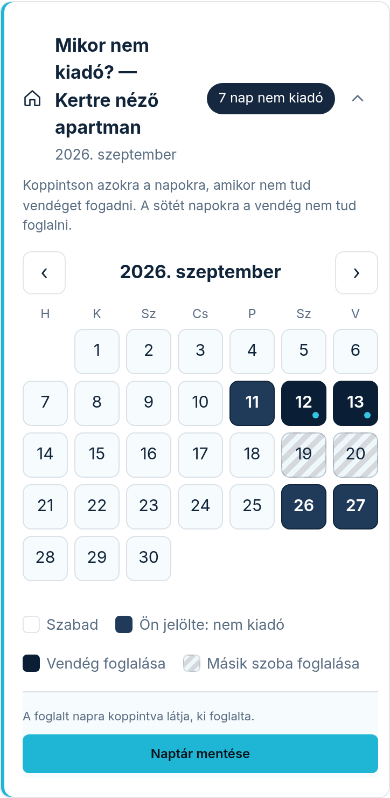

A foglalás-modul beállító-képernyőjét a Modulok fülön, a modul melletti **„Beállítás”** linkkel éri
el. Itt a naptárát, a kiadott szobáit és az értesítési címeit kezeli.

## Mi hol van a képernyőn?

A sötét fejléc-blokk alatt egy sor kis gomb áll: **„Mikor nem kiadó?”**, **„Hirdeti máshol is?”**,
**„Mit ad ki?”**, **„Foglalás beállítása”**, **„Haladó beállítások”**. Ez a sor görgetés közben is a képernyő
tetején marad, egy gombra koppintva a lap arra a részre ugrik, és mindig az a gomb van kiemelve, amelyik
résznél éppen jár. Számítógépen ugyanez a lista a jobb szélen áll, **„Ezen a lapon”** címmel. A lap részei
csoportokba vannak rendezve, a csoport címe után egy vonal fut a lap széléig: a naptár, aztán
**„Portálok”** (a Booking.com, a Szállás.hu és az Airbnb összekötése), aztán **„Szobák és beállítások”**
(a kiadott szobái, a kérdésről kérdésre beállítás és a haladó beállítások).

## A beállítások: kérdésről kérdésre

A naptár és a kérések alatt áll a **„Foglalás beállítása”** kártya. A **„Beállítom kérdésről
kérdésre”** gomb egy külön oldalt nyit, ahol a szobákat, az árakat, az időszakokat és a foglalás
szabályait egymás után, kérdésekre válaszolva adja meg — egy Segítővel, aki elmagyarázza, amit nem
ért. Ezt az oldalt a „Foglalás beállítása” súgója írja le.

A korábbi beállító űrlap (az alábbi mezők: értesítési cím, idegenforgalmi adó,
legrövidebb és leghosszabb foglalás) megmaradt: a kártya alatti **„Haladó beállítások”** sorra
koppintva nyílik ki. Ugyanazokat az adatokat írja, mint a kérdezős oldal.

## Hol válaszolok a foglalási kérésekre?

A beérkezett kérések a **„Foglalások”** fülön várják — ott igazolja vissza vagy utasítja el őket,
üzenettel a vendégnek. Ha ezen a képernyőn kérés vár döntésre, egy sáv jelzi, és a
**„Foglalások megnyitása”** gomb odaviszi. A döntést a kérésről kapott e-mailből is elintézheti,
belépés nélkül: a levél **„Gyors döntés innen is:”** sorának linkje egy megerősítő lapot nyit, és
ott az **„Igen, elfogadom”** vagy az **„Igen, elutasítom”** gombbal dönt — a vendég csak azután kap választ, hogy Ön döntött.

## Hová érkezzenek az értesítések?

A **„Hová küldjük a foglalási kéréseket?”** mezőben (a képernyő alján a **„Haladó beállítások”** sorra koppintva nyílik ki; ugyanezt kérdezi a **„Foglalás beállítása”** oldal is) adja meg a címet — több címet is megadhat
vesszővel elválasztva (pl. recepció és tulajdonos). A vendég válasza is az első címre fut be.
Üresen hagyva a fiókja e-mail címére küldjük.

## Mit fizet a vendég a helyszínen? (idegenforgalmi adó)

Az **„Idegenforgalmi adó”** mezőbe (a képernyő alján a **„Haladó beállítások”** sorra koppintva nyílik ki; ugyanezt kérdezi a **„Foglalás beállítása”** oldal is) azt az összeget írja be, amit a vendég a **helyszínen**
fizet a szállásdíjon felül — **Ft / fő / éj** bontásban. A honlapján ez az összeg nem olvad
bele az árba: külön dobozban áll, „A helyszínen fizetendő ezen felül” felirattal, kiszámolva
(pl. *500 Ft / fő / éj × 2 fő × 3 éj = 3 000 Ft*). A 18 év alatti vendég mentes: akiket a vendég
a foglalásnál gyermekként ad meg, azokra nem számoljuk, és a doboz ezt egy mondatban ki is mondja.

**Ha üresen hagyja**, a kinyitott Haladó beállítások alatt, a mező alatt egy borostyán keretes emlékeztető jelenik meg, és a honlapján
**nem látszik összeg** — a vendég csak annyit lát, hogy a helyszínen idegenforgalmi adó fizetendő.
Összeget nem találunk ki Ön helyett: egy rossz szám többet árt, mint a hiányzó. Az emlékeztető
magától eltűnik, amint ment egy értéket.

A vendég az adót a kérés elküldése **után** is látja: ugyanez a sor áll a képernyőn megjelenő
visszaigazolásán („Elküldtük a kérését”), a „rögzítettük” levélben és a visszaigazoló levélben is.
A levelek azt az összeget írják, ami a kérés elküldésekor érvényes volt — ha később átírja a mezőt,
a már beérkezett kérések levelei nem változnak. Telefonon a foglalás második lépésében, az összeg
alatt is ott áll, és a létszám változtatásával együtt frissül.

**Ha Önnél nincs idegenforgalmi adó, írjon be 0-t** — és mentsen. Ez nem ugyanaz, mint üresen
hagyni: a 0 azt jelenti, hogy Ön **kimondta**, hogy nincs, ezért a honlapja **nem is említi** az
adót. Az üres mező azt jelenti, hogy még nem nyilatkozott — olyankor a lap kiírja, hogy a
helyszínen adó fizetendő, összeg nélkül.

⚠️ **Az ár-bontás csak akkor jelenik meg, ha van árlistája.** Az árakat az **Árak, szezonok**
modulban adja meg (külön modul) — vagy a „Foglalás beállítása” oldal „Árak” részében. Amíg ott nincs egyetlen ár sem, a vendég a naptárban választhat
napokat, de ár — és vele az idegenforgalmi adó doboza — nem jelenik meg.

Azt, hogy mi van még benne az árban (pl. *takarítás, ágynemű, törölköző*), mostantól az
**Árak, szezonok** modul **„Ellátás”** részében, a **„Mi van még benne az árban?”** mezőben adja
meg — ugyanott, ahol a reggelit és a félpanziót. A korábban beírt szöveg változatlanul megmaradt.

## A naptár kezelése

A képernyő tetején egy sötét sáv áll: benne a modul neve és díja, alatta a
**„Vissza a modulokhoz”** link (előtte egy ‹ nyíl) és az **„Útmutató ehhez a képernyőhöz”**
(ez nyitja ezt a súgót).

A **„Mikor nem kiadó?”** naptárban koppintson azokra a napokra, amikor nem tud vendéget fogadni.
A **„Naptár mentése”** gombbal rögzíti a változást. A ‹ és › nyilakkal lapozhat a hónapok között.

A naptár **összecsukható**: a fejléc-sorára koppintva becsukódik, és becsukva is kiírja, hány nap
nem kiadó abban a hónapban (például „3 nap nem kiadó”; ha egy sincs: **„minden nap kiadó”**). Újra koppintva
kinyílik.

## A nap-fajták — és melyik mit csinál koppintásra

Az első három állapot mindig szerepel a jelmagyarázatban, akkor is, ha abban a hónapban
egyetlen ilyen nap sincs. A **„Másik szoba foglalása”** sor viszont csak akkor jelenik meg,
ha tényleg van ilyen nap — ezért gyakran csak az első hármat látja:

| Jelmagyarázat | Mit jelent | Mi történik, ha rákoppint |
|---|---|---|
| **„Szabad”** | Foglalható éjszaka | Tele lesz (sötétkék). Mentés után a vendég nem tudja lefoglalni. |
| **„Ön jelölte: nem kiadó”** | Az Ön saját blokkja (közepes kék) | **Újra szabaddá válik** — így vonja vissza, ha mégis ki tudja adni. |
| **„Vendég foglalása”** | Egy elfogadott foglalás (legsötétebb, apró világoskék ponttal) | **Felugrik a foglalás részlete** — lásd a következő szakaszt. Felszabadítani itt nem lehet. |
| **„Másik szoba foglalása”** | Csíkos: a szállás egy másik szobája tartja. **Csak akkor jelenik meg, ha van ilyen nap.** | Felugrik, hogy **melyik szoba** és **ki** tartja. Itt nem oldható fel. |

## Mi van egy foglalt nap mögött?

A foglalt napra koppintva **a képernyő közepén felugrik a nap részlete**:

- **Vendég-foglalásnál** a vendég neve, az időszak és az éjszakák száma, a létszám, az ár (ha volt
  árlista), valamint az **e-mail címe és a telefonszáma — mindkettő kattintható**, tehát azonnal
  hívhatja vagy írhat neki. Ha a vendég üzenetet hagyott, az is itt olvasható. Gombok:
  **„Foglalás megnyitása”** (a Foglalások fülre visz) és **„Írok a vendégnek”**.
- **Csíkos napnál** az, hogy **melyik szoba** tartja. Ha ott vendég-foglalás van, a vendég neve és
  az időszaka is látszik, és a **„Foglalás megnyitása”** gombbal megnyithatja; ha viszont csak
  kézzel jelölte nem kiadónak azt a szobát, a kártya ezt írja: „Ezt a napot a … naptárában
  jelölte nem kiadónak”. Mindkét esetben ott az **„Átváltok a naptárára”** gomb.

A kártyát az **×** jellel vagy a mögötte lévő sötét háttérre koppintva zárja be.

## Ha a Booking.com-on, a Szállás.hu-n vagy az Airbnb-n is hirdet

Kösse össze a naptárakat, így nem kell két helyen lezárnia ugyanazt a napot: ami a portálon
foglalt, az itt is lezár, és ami itt foglalt, az a portálon is. A naptár alatti
**„Hirdeti máshol is?”** kártyán mindhárom portálnak saját doboza van, két lépéssel:

1. **A portál naptár-linkjét hozza ide.** A portálon a naptár-szinkron menüben kap egy linket
   (Booking.com: Árak és elérhetőség › Naptár › naptár-szinkronizálás; Szállás.hu: Árak és kapacitás › Naptár
   szinkron (iCal); Airbnb: Naptár › Foglalhatóság › Naptárak bekötése — angol felületen Rates & Availability ›
   Sync calendars, illetve Calendar › Availability › Connect calendars). Másolja be a mezőbe, és
   nyomja meg az **„Összekötés”** gombot — azonnal megnézzük, és kiírjuk, hány foglalt napot hoztunk át.
2. **A mi linkünket adja meg a portálnak.** A **„Másolás”** gombbal vágólapra teszi, és a portál
   ugyanazon menüjében, a naptár importálásánál illeszti be.

Minden dobozban ott a **„Segítség: így köti össze lépésről lépésre”** sor: kinyitva a portál
saját menüpontjaival vezeti végig. Egy rossz linket a **„Leválasztás”** gombbal bonthat: helyben
megkérdezzük, és kiírjuk, hány, a portálról hozott nap szabadul fel — csak az **„Igen, leválasztom”**
gomb választja le (a **„Mégsem”** bezárja a kérdést). A portálról hozott napok ekkor eltűnnek a naptárából.

A dobozban azt is látja, mikor frissült utoljára, és hogy a mai naptól összesen hány foglalt
napot hoztunk át (a naptár fölötti jelvény csak a látott hónapot számolja). A Szinkron-napló
sort kinyitva az utolsó tíz frissítés látszik: mikor sikerült, és mikor nem.

### Ha a doboz hibát vagy figyelmeztetést mutat

- **Piros „Hiba” felirat:** a legutóbbi frissítés nem sikerült. A doboz kiírja, mikor, mi történt,
  és hogy a korábban áthozott foglalt napok érvényben maradnak — egy hibás frissítés soha nem
  szabadít fel napot. Azt is látja, mikor sikerült utoljára. Ha a portálon új linket kapott,
  válassza le a régit, és kösse össze az újjal. Ha a hiba egy napig tart, e-mailt is küldünk
  róla — egyszer; ha a link újra működik, és később megint elakad, újra szólunk.
- **„A link nem érhető el, vagy nem naptár”:** a link nem a portál naptár-exportja, vagy nem
  nyitható meg. Másolja be újra a portál naptár-szinkron menüjéből.
- **Ütközés:** a portál olyan éjszakát jelez foglaltnak, amelyre Ön nálunk már elfogadott egy
  foglalást. A doboz kiírja a napot és a vendég nevét, és e-mailt is kap róla (ütközésenként
  egyszer). Egyik foglalást sem töröljük: Ön dönti el, melyik vendéget tudja fogadni, és a
  másikkal a portálon vagy a Foglalásoknál rendezi.
- **„Figyelem: a portál most üres naptárat adott”:** a portál egyszerre minden foglalást
  szabadnak mutat, ezért az addig áthozott napok felszabadultak. Ez szabályos, ha ott tényleg
  lemondták őket — ha nem, nézze meg a portál naptárát.
- **„… bejegyzést nem tudtunk pontosan értelmezni”:** a portál naptárában van olyan bejegyzés,
  amelyet kihagytunk, vagy egy éjszakának vettünk. Kinyitva látja, melyiket. Ha egy portálon
  látott foglalás itt hiányzik, ez lehet az oka.

A **„Másolás”** gombbal kapott link portálonként más: a portálnak szóló naptárunkból kimaradnak
azok a napok, amelyeket épp attól a portáltól kaptunk — a többi portál viszont látja őket.

Jó tudni:

- Minden szobát külön kell összekötni — a portálokon is szobánként van naptár. Az egész háznak
  nem kell saját link: ha szobánként adja ki, a ház napjai a szobák napjai.
- Csak a foglalt napok mennek át; az árat és a vendég adatait a portálon továbbra is ott kezeli.
- Nem azonnali: mi óránként nézzük meg a portált, a Booking.com kétóránként a mi naptárunkat
  (ott az „Import now” gombbal azonnal is frissítheti).
- A Booking.com csak akkor engedi a naptár-összekötést, ha ott egy szobatípus egy szobát jelent, és
  nem használ channel managert.

## Szobák, apartmanok

A **„Mit ad ki?”** részben veszi fel, amit kiad: ha több szobája vagy apartmanja van, mindegyiknek
saját naptára lesz, így külön telhetnek be. Új szobát a szaggatott keretes **„Új szoba
felvétele”** sávra koppintva, a név és a férőhely megadásával, a **„Hozzáadás”** gombbal vehet fel;
a meglévőt (a **„Meglévő szobája”** felirat alatt — több szobánál **„Meglévő szobái”**)
átnevezheti, és ha már több szobája van, a **„Törlés”** gombbal eltávolíthatja — az egyetlen
szobánál ez a gomb nem látszik.
Ha az Árak modul is be van kapcsolva, a **„Hozzáadás”** megnyomása ELŐTT az **„Alapár”** is
megadható, vagy bepipálható alatta a **„Nem adok meg árat — egyedi ajánlatot küldök”**.
Egyik sem kötelező. Ha egyik sincs, a mentés után egy sárga sor figyelmeztet: az **„Árat adok
meg”** gomb az Árazás lapra visz (ott írja be és mentse az árat), a **„Nem adok meg árat”** gomb
pedig helyben rögzíti, hogy egyedi ajánlatot küld.
Több szobánál a naptár fölött **fülek** vannak: arra koppint, amelyiknek a naptárát nézni akarja.
Fület csak az kap, amit a vendég le is foglalhat. Ha a házat csak egyben adja ki, a szobák a fülek
alatt egy mondatban szerepelnek („a házzal együtt foglalható, ezért nincs külön naptára”), mert
foglalás csak a házra érkezhet. Ha szobánként adja ki, fordítva: az egész háznak nincs füle, és a
fülek alatt egy mondat mondja meg, miért („aki az egészet kéri, minden szobát kijelöl, ezért nincs
külön naptára”).
A szoba nevének átírása után a sor **„Mentés”** gombjával rögzíti a változást.

### Több szoba egy kérésben — és az egész ház

Több szobánál a vendég egy kérésben **egy vagy több szobát** foglalhat, akár mindet. Az egész
háznak ilyenkor nincs külön ára és naptára: aki az egész házat kéri, minden szobát kijelöl, és a
szobák árát fizeti. A vendég a honlapon előbb a napokat választja ki, utána a listában pipálja be a
szabad szobákat; a naptár egy éjszakát csak akkor mutat foglaltnak, ha arra egyik szoba sem
szabad. A több szobás kérést Ön egyben igazolja vissza (vagy utasítja el) a **„Foglalások”**
fülön — ilyenkor mindegyik kijelölt szoba naptárában foglalt lesz az időszak, és mindegyiknél
sima **„Vendég foglalása”** napként látszik (nem csíkosan).

Ha a házat **csak egyben** adja ki, fordított a helyzet: akkor csak az egész ház foglalható, a
szobák csak bemutatásra szerepelnek. Ezt a Szobák, apartmanok modul beállító-képernyőjén, a rács
fölötti **„Az egész ház”** kártyán pipálhatja be (**„Csak egyben adom ki”**) — ilyenkor ott adja
meg a ház árát is.

### Miért csíkos néha egy nap

Az egész ház és a szobái kizárják egymást: ha az **egész házra** van foglalás egy napra (például
egy korábbi, még az egész házra érkezett kérésből), az összes szobája **automatikusan foglalt**
arra a napra; és ha **bármelyik szobája** foglalt, az egész ház **nem adható ki** arra a napra.

Ezek a napok a másik szoba naptárában **csíkosan** jelennek meg. Ott nem lehet felszabadítani őket
(különben ugyanaz az éjszaka kétszer kelne el) — a napra koppintva viszont látja, ki tartja, és egy
gombbal átválthat annak a szobának a naptárára. Két szoba egymást nem zárja: azok egymástól
függetlenül telnek be. Bármelyik szoba törölhető a sora **„Törlés”** gombjával; az egész ház csak
akkor, ha már csak egy szobája van. A gomb előbb megerősítést kér, és felsorolja, mi vész
el a szobával (lezárt napok, árak, naptár-szinkron, korábbi foglalások); a törlés az **„Igen,
törlöm”** gombbal történik meg. Nem törölhető az utolsó szoba, az, amelyikre egy kérés még a
döntésére (vagy egy ajánlata a vendég válaszára) vár, és az, amelyikhez elfogadott, le nem zárult
foglalás tartozik — ilyenkor a megerősítés helyén megjelenik, melyik kérés tartja, és a
**„Foglalások”** gomb oda visz. A részletek a Szobák, apartmanok súgójában.
