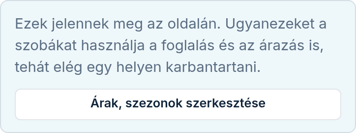
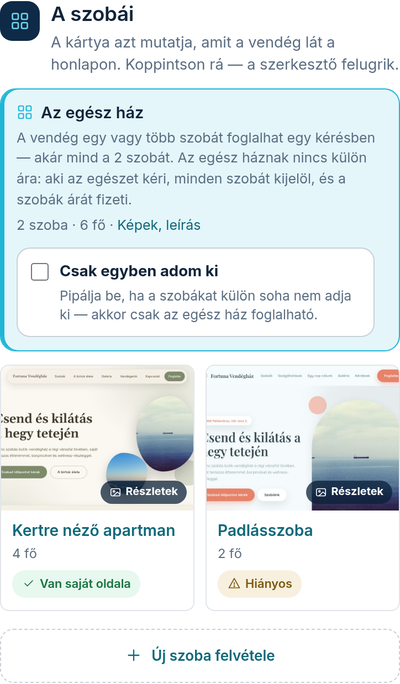
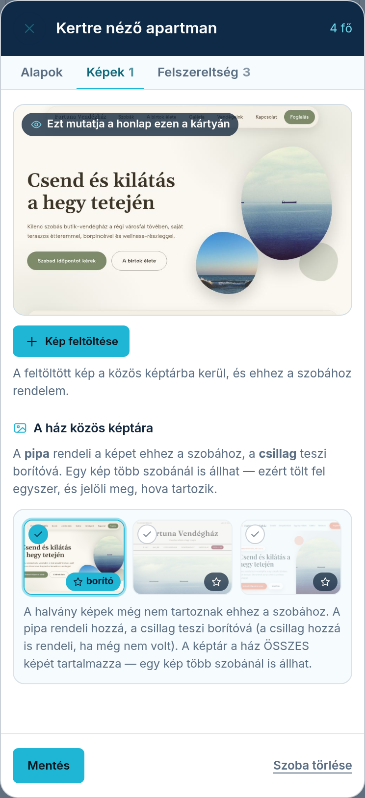

A szoba-modul beállító-képernyőjét a Modulok fülön, a modul melletti **„Beállítás”** linkkel éri
el. Itt adja meg, milyen szobákat, apartmanokat ad ki, és mit tudjon róluk a vendég.

Fontos: ugyanezeket a szobákat használja a foglalási naptár és az árazás is — elég egy helyen
karbantartani, és mindenhol egyezni fog. Ha a szobák megvannak, és árat adna nekik, nem kell
keresgélnie: a képernyő tetején, a bevezető szöveg alatt (számítógépen mellette) az **„Árak, szezonok szerkesztése”** gomb
egyenesen az ár-modul beállító-képernyőjére visz. Ha az Árak modul még nincs bekapcsolva, a gomb
felirata **„Árak modul bekapcsolása”**, és a Modulok fülre visz — ott az Árak, szezonok kártyán a
**„Kosárba teszem”** gombbal tegye a kosarába, és a kosárban véglegesítse.

## A szobák rácsa

A **„A szobái”** cím alatt minden szobája egy kártyán látszik, és a kártya pontosan azt mutatja,
amit a vendég lát a honlapon: a **borítóképet**, a nevet, a férőhelyet. A képen jobb alul a
jelvény a képek számát írja, egyetlen képnél a **„Részletek”** szót — mert az „1 kép” galériát
ígérne. A név alatt az állapot áll: **„Van saját oldala”** vagy **„Hiányos”**.

Ha ugyanaz a fénykép két szoba borítója, azt a kártya piros jelvénnyel kimondja, és megnevezi a
másik szobát — így nem fordulhat elő észrevétlenül, hogy a honlapon két szoba ugyanazzal a
képpel szerepel.

Új szobát a lap alján, a szaggatott keretes **„Új szoba felvétele”** sávra koppintva vesz fel:
kinyílik egy kiemelt doboz, abban adja meg a nevét, a férőhelyét, és nyomja meg a
**„Hozzáadás”** gombot. A doboz alapból csukva van, hogy ne keverje össze a meglévőkkel: a
meglévő szobái fölötte, a kártyarácsban állnak, és azokat a kártyájukra koppintva szerkeszti. Ha csak egyben adja ki az egész szállást, elég
egyetlen szoba — ilyenkor a vendég nem is találkozik a szobaválasztással.

Amikor a **második** egységet veszi fel, az eddigi egyetlen egysége általában maga a szállás
(egy új fióknál ez az alap, „A szállás egésze” néven): ez marad **az egész ház**, a most felvett
pedig az első szobája. Ilyenkor nincs kérdés.

Ha ezt az egyetlen egységet korábban átnevezte, csak Ön tudja, mi az. Ekkor ugyanebben az
űrlapban, közvetlenül a **„Hozzáadás”** fölött egy kérdés vár, a nevén nevezve: **„Mi az eddigi
„…”?”** Két válasz közül választhat:

- **„Az egész ház”**: az marad az egész ház, a most felvett az első szobája.
- **„Az első szobám”**: az eddigi egység szoba lesz (a naptára, képei és ára megmarad), az egész
  házat pedig a rendszer külön felveszi, ár nélkül.

Ha kihagyja, a gomb alatt piros sor mondja meg, mi hiányzik, és a kérdés pirosan kiemelődik —
válasszon, és nyomja meg újra a gombot. Ha egy elnevezett szoba maradt egyedül (például egy
törlés után), nincs kérdés: az szoba marad.

Ha az Árak modul is be van kapcsolva (és nem csak egyben adja ki a házat), a **„Hozzáadás”** megnyomása ELŐTT ugyanitt az árat is
megadhatja (**„Alapár”** mező), vagy bepipálhatja az alatta lévő négyzetet: **„Nem adok meg árat —
egyedi ajánlatot küldök”**. Egyiket sem kötelező kitölteni, a szoba mindenképp felkerül. Ha a
beírt árat nem tudjuk értelmezni (például betűvel írta), a szoba ár nélkül kerül fel, és a sárga
sor ezt is megmondja. Ha se ár, se pipa nincs, a mentés után egy sárga sor mondja ki,
hogy a szobát felvettük, de nincs ára. Mellette az **„Árat adok meg”** gomb az Árazás lapra visz, a
**„Nem adok meg árat”** gomb pedig ott helyben rögzíti, hogy egyedi ajánlatot ad.

## A szerkesztő: koppintson a kártyára

A kártyára koppintva felugrik a szerkesztő. Bezárni a bal felső **×**-szel, a felugró melletti
sötét háttérre koppintva vagy az `Esc` billentyűvel tud. A **„Mentés”** gomb végig a felugró
alján marad, tehát nem kell hozzá végiggörgetni. Három fül van benne:

### „Alapok”

Itt van egy helyen a szoba **neve**, a **férőhelye** és a **leírása** — pár mondat arról, mi
jellemzi ezt a szobát, mit szeretnek benne a vendégek. Számítógépen a jobb oldalon rögtön látja is
azt a kártyát, amit a vendég kapni fog.

A férőhely a foglalás felső határa is: a vendég ennél több főre nem kérhet foglalást ebbe a
szobába. Ha később csökkenti, a már beérkezett, több főre szóló kérésnél a **„Foglalások”** fülön
figyelmeztetés jelzi a különbséget.

### „Képek”

Felül nagyban látszik a **borítókép**, azzal a felirattal, hogy **„Ezt mutatja a honlap ezen a
kártyán”**. Ez az a kép, amit a vendég a szoba kártyáján lát.

A **„Kép feltöltése”** gombbal innen, a szobából is tölthet fel fényképet. A feltöltött kép a
**ház közös képtárába** kerül, és egyből ehhez a szobához is hozzárendeljük — egy képet tehát
elég egyszer feltölteni, akkor is, ha több szobánál szeretné megmutatni. Ha a szobának még nem
volt borítóképe, az első feltöltött lesz az; ha volt, azt nem írjuk felül.

Ha valamelyik fájlt nem tudjuk elfogadni (nem JPEG/PNG/WEBP, vagy nagyobb 6 MB-nál), megírjuk,
**melyik fájl** és **miért** maradt ki — a többit ilyenkor is feltöltjük.

Alatta **„A ház közös képtára”** következik, benne a szállás összes képe. A halvány képek még nem
tartoznak ehhez a szobához.

* a **pipa** (bal felső sarok) rendeli a képet ehhez a szobához — a mentéssel rögzül;
* a **csillag** (jobb alsó sarok) teszi borítóképpé. Ha a kép még nem tartozott ehhez az
  szobához, a csillag hozzá is rendeli, és ezt ki is írjuk.

Ha kivesz egy képet a szobából (a pipát leveszi, majd ment), a kép a **közös képtárban benne
marad** — nem törli. Ha éppen az volt a borítókép, a sorban következő lép a helyébe; ha nem
maradt kép, azt is megírjuk.

### „Felszereltség”

Itt azt sorolja fel, ami **ebben a szobában** van (a ház egészére vonatkozó tételeket a
Felszereltség modulnál állítja). A kiválasztott tételek kis címkéken látszanak; újat a
**„Hozzáadás a listából”** résznél vesz fel, ikonos csempéken. Ha még egy tétel sincs kiválasztva,
a lista rögtön nyitva van. A kereső mezőbe beírva gyorsan megtalál bármit (pl. „stég”). Ami nincs
a listában, azt az **„Egyéb, ami nincs a listában”** mezőbe írhatja, soronként egyet. Amit a
Felszereltség modulnál a ház egészénél már bejelölt (pl. wifi, reggeli), az itt is választható, és
a csempéjén egy kis felirat jelzi: **„a ház egészénél is”**. Nyugodtan jelölje be a szobánál is —
a vendég a szoba saját oldalán csak a szoba listáját olvassa.

Ez a fül csak akkor szerkeszthető, ha a **Felszereltség** modul be van kapcsolva — ha nincs, a fül
megmutatja, mit tudna itt beállítani, és a Modulok fülre hív.

## Mikor lesz saját oldala egy szobának?

Ha egy szobához van legalább **egy hozzárendelt fotó** ÉS **leírás vagy felszereltség**, a
szoba saját aloldalt kap az Ön honlapján — a keresők (Google) külön is megtalálják, ami több
vendéget hozhat. A rács kártyáján és az **„Alapok”** fülön is mindig kiírjuk, hogy az adott
szobának lesz-e saját oldala, és ha nem, mi hiányzik hozzá. Üres oldalt sosem készítünk — az
többet ártana, mint használna.

## Az egész ház

Ha egynél több szobája van, a vendég **egy szobát vagy az egész házat** foglalhatja. Az egész ház
nem az egyik szobája, hanem külön tétel: a rács fölött saját kártyája van, **„Az egész ház”**
címmel. Ha az egész házat foglalják le, minden szoba betelik arra az időre; ha egy szobát, az egész
ház nem foglalható arra az időre.

A kártyán:

- látja, hány szoba és hány fő tartozik a házhoz; a **„Képek, leírás”** linkre koppintva a ház
  saját szerkesztője nyílik meg (képek, leírás, felszereltség);
- megadhatja a ház **alapárát** (ha az Árak modul be van kapcsolva): írja be a mezőbe, és nyomja
  meg az **„Ár mentése”** gombot. Ha üresen menti, az ár törlődik, és a vendég árajánlatot kér.
  Az ár nem a szobák összege — azt Ön adja meg;
- egyetlen pipa van: **„Csak egyben adom ki”**. Pipálja be, ha a szobákat külön soha nem adja ki.
  Ekkor a vendég csak az egész házat foglalhatja; a szobák a rácson „csak bemutatásra” jelölést
  kapnak: a honlapon képpel és felszereltséggel látszanak, de ár és foglalás nélkül. Árat ilyenkor
  csak a házra kérünk — az Árak lapon a szobáknak nincs kártyája, és az ár hiánya miatt sem a
  teendők között, sem levélben nem szólunk. A pipa magától ment.

Egyetlen szobánál a kártya nem jelenik meg — ilyenkor nincs mit eldönteni.

Bármelyik szobát törölheti a felugrója alján lévő **„Szoba törlése”** gombbal. Az egész házat
csak akkor, ha már csak egy szobája van — több szobánál a szerver elutasítja: „Az egész ház nem
törölhető, amíg több szobája van.” A gomb nem töröl azonnal:
alatta megnyílik egy megerősítés, ami név szerint kérdez rá a szobára, és felsorolja, mi vész el
vele együtt: **„A szobával együtt végleg törlődik:”** a naptárából lezárt napok, az alapár és az
időszaki árak, a naptár-szinkron (a portál nevével) és a korábbi, lezárt foglalások — mindegyik
darabszámmal. A szoba képei a galériában maradnak. Ha biztos benne, nyomja meg az **„Igen, törlöm”**
gombot; ha meggondolta magát, a **„Mégsem”** gombot. A törlést nem lehet visszacsinálni.

Három esetben a szoba nem törölhető. Az utolsó szobánál a gomb meg sem jelenik. Ha a szobára egy
foglalási kérés még a döntésére vár, vagy egy árajánlata a vendég válaszára, a megerősítés helyén
egy sárga keretes jelzés áll: megmutatja a kérés hivatkozását, időszakát és a vendég nevét, és a
**„Foglalások”** gombbal oda visz, ahol dönthet róla. Így a vendég nem marad válasz nélkül. Ugyanez
a jelzés áll ott, ha a szobához elfogadott, még le nem zárult foglalás tartozik.

Ha a törlés után egyetlen szobája marad, az a szoba **marad szoba**: ha később újat vesz fel,
az űrlap nem kérdez semmit, és a két szoba mellé a rendszer magától felveszi az egész házat, ár
nélkül — az árát a ház kártyáján adhatja meg.