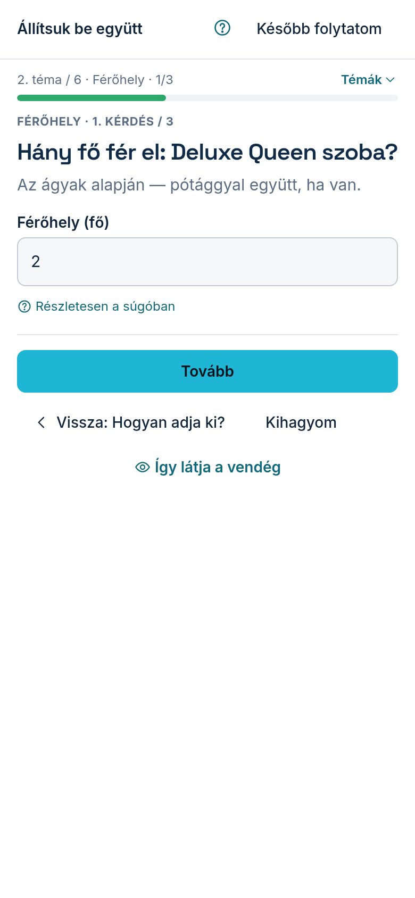

Az első belépéskor egy teljes képernyős beállítás nyílik meg: **„Állítsuk be együtt”**. Minden
modulon végigvezeti, amit megvett — kérdésenként, egyszerre egyet kérdez. Nem kell tudnia, melyik
menüben mi van: Ön válaszol, a rendszer beírja a megfelelő helyre. Amit itt megad, ugyanaz, mintha a
modul saját lapján állította volna be.

## Hogyan halad végig?

1. Az első kérdés: hogyan adja ki a szállást — egészben, szobánként, vagy egyben úgy, hogy a
   szobákat csak bemutatja. Ettől függ minden további kérdés.
2. Szobánkénti kiadásnál megadja, hány szobája van, és mi a nevük. A szobák ezzel létrejönnek;
   mellettük az egész ház is foglalható marad.
3. Utána a férőhelyet és az árat szobánként kérdezi — minden szobához külön kérdés jön.
4. A gomb a következő kérdésre visz: **„Tovább”**, egy téma utolsó kérdésénél **„Mentés, tovább”**.

Telefonon a lap tetején látja, hányadik témánál tart; a **„Témák”** feliratra koppintva lenyílik a
teljes lista. A kérdés alatt az **„Így látja a vendég”** feliratra koppintva megnézheti, mit lát a
vendég a honlapján. Számítógépen a témák listája a bal oldalon áll, a vendég-nézet pedig jobbra —
ez minden válasz után frissül.

Néhány témát a meglévő lapján állít be (például a Heti programajánlót). Ilyenkor a beállítás egy
gombbal megnyitja azt a lapot, és a lap tetején egy sötét sáv áll:
**„Kész — vissza a beállításhoz”**. Erre koppintva a beállítás a következő témával folytatódik.

## Ha valamit elrontott

Mindenhol vissza tud lépni. A **„Vissza”** az előző kérdésre visz; egy téma első kérdésénél a gomb
az előző téma nevét mutatja, és annak utolsó kérdésére visz vissza. A témák listájában minden kész
téma mellett ez áll: **„Kész — szerkeszthető”**. Rákattintva újra megnyílik, a mentett válaszaival.
Ha például később mégis szobánként adja ki a házat, a férőhely és az ár kérdései szobánként újra
megjelennek.

## Ha most nem ér rá

- **„Később folytatom”**: elmenti, hol tart. Az Áttekintés tetején a **„Folytatom”** gomb oda visz
  vissza, ahol abbahagyta — másik eszközről is.
- **„Kihagyom”**: a témát a sor végére teszi; ha más téma erre vár, azt is megmondja.
- **„Most kihagyom”**: a nem kötelező témáknál (például a saját fotók) — később bármikor elővehető.

Ami egy másik témára vár, lakattal áll a listában, és megmondja, mire vár — például: előbb az árak
kellenek, mert a foglalás összeget mond.

## Ha egy válaszhoz modul kell

Ha olyat választ, amihez a csomagjában nincs modul (például szobánkénti kiadáshoz a Szobák modul),
a beállítás megmondja, melyik kell és mennyibe kerül. Két út van: megrendeli — ekkor a meglévő
modul-kosárba kerül, és a fizetés után a beállítás ott folytatódik, ahol abbahagyta —, vagy egyelőre
egészben adja ki a szállást.

## Hol látja később, mi hiányzik?

- Az Áttekintés tetején: hány téma kész, és mi a következő. Ha minden kész, ugyanott a
  **„Beállítás átnézése”** gombbal bármelyiket újra végigveheti.
- A Modulok fülön minden téma egy kártya: zöld, ha kész, piros vagy sárga, ha valami hiányzik, és
  ott áll, mi hiányzik — szobánként is, például „1/3 szobának van ára”.
- A modul saját lapján felül ugyanazok a kérdések jelennek meg, ha még van megválaszolatlan. Az
  **„Elrejtem”** gombbal összecsukhatja őket; ilyenkor egy keskeny sor marad, a **„Folytatom”**
  gombbal (kész témánál **„Átnézem”**) bármikor újra kinyithatja.

Ha valamelyik témánál úgy dönt, hogy nem ad meg valamit — például az árnál bejelöli:
**„Ennél nem adok meg árat”**, mert mindig egyedi ajánlatot küld —, az nem hiány: a kártyán az áll, hogy
**„Ön döntött így”**, és többé nem emlékeztetjük rá.
