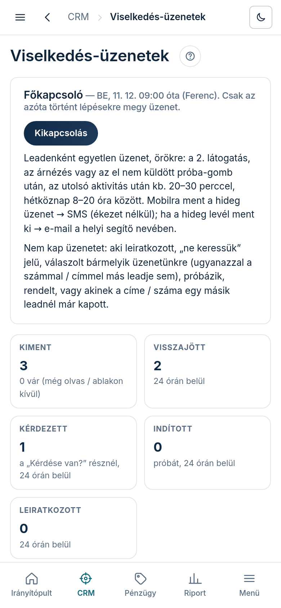

A viselkedés-üzenet egyetlen automatikus SMS vagy e-mail, ami akkor megy ki a leadnek, amikor ő maga
lép a honlap-tervén: **visszajön** megnézni, **megnézi az árat** („Árak és rendelés”), vagy
**megnyomja a próba-gombot, de nem küldi el**. Leadenként egyszer, örökre. Ember nem ír, a szöveg a
lead adataiból áll össze (név, saját cím, ár, a próba napjai).

## Hol találod

A bal menüben **„CRM”** → **„Viselkedés-üzenetek”**.

## Mit mutat

- **„Főkapcsoló”**: **„Bekapcsolás”** / **„Kikapcsolás”**. Alapból KI, ilyenkor semmi nem megy ki.
  Bekapcsoláskor csak az onnantól történő lépések számítanak; a régi látogatásokra nem megy
  visszamenőleg üzenet. Mellette látod, mióta és ki kapcsolta be.
- **Öt szám**: **„Kiment”** (alatta, hány üzenet vár még), és hogy a kiment üzenet után **24 órán
  belül** hányan **„Visszajött”**, **„Kérdezett”** (a terv „Kérdése van?” részénél), **„Indított”**
  (próbát) és **„Leiratkozott”**.
- **„Ki mit kapott”**: üzenetenként egy sor — a lead neve, mire jött (**„Visszajött”** /
  **„Árnézés”** / **„Próba-gomb”**), melyik üzenetet kapta, SMS vagy e-mail, mikor, és mi lett belőle
  24 órán belül. **Egy sorra koppintva** látod a pontos szöveget, ami kiment. A szűrők: **„Mind”**,
  **„Visszajött”**, **„Árnézés”**, **„Próba-gomb”**, és **„Leállítva”**: azok a leadek, akik léptek,
  de egy szabály miatt nem kaptak üzenetet (az oszlopban az ok).
- **„Kiváltónként”**: ugyanez összesítve, kiváltónként.

## Mikor és mit kap a lead

- **Mikor:** az utolsó aktivitása után kb. 20–30 perccel (a rendszer 10 percenként néz rá; ha a lead
  közben újra megnyitja a tervet, az üzenet vár), **hétköznap 8 és 20 óra között**. Ami este vagy hétvégén történik, az a következő hétköznap reggel
  megy; ami 4 napnál régebbi, az már nem megy ki.
- **Mit:** a lépéshez illő egyetlen mondatot, egyetlen linkkel a terv megfelelő részére:
  visszajött → „Kérdése van?” rész; árnézés → az ár és hogy mi van benne; próba-gomb → az egy
  kattintásos indítás. Kedvezményt, határidőt, „láttuk, hogy megnézte” mondatot nem tartalmaz.
- **Csatorna:** ha a hideg megkeresés a mobiljára ment, SMS (ékezet nélkül, legfeljebb 2 szelet);
  ha a hideg levél ment ki, e-mail a helyi ügyfélsegítő nevében, leiratkozó linkkel. Ha egyik sem,
  nem kap üzenetet (a **„Leállítva”** alatt látod, „nincs csatorna” okkal).

## Ki NEM kap üzenetet

Aki leiratkozott; akin „ne keressük” jel van; aki **bármelyik üzenetünkre válaszolt** (a válasza a
jóváhagyó sorba megy, onnan te döntesz); aki próbázik vagy próbázott; aki rendelt; akinek a címe vagy
mobilszáma egy másik leadnél már kapott üzenetet; és akinek a terve nincs jóváhagyva. A válasz és a
„ne keressük” jel az EMBERRE szól: ugyanazzal a mobillal vagy címmel egy másik leadje sem kap üzenetet.
Néhány technikai ok is leállít (teszt, kizárt lead, archivált link) — a **„Leállítva”** szűrő minden
esetben kiírja az okot.

## Mit tegyél

Semmit — ha a főkapcsoló be van kapcsolva, a rendszer magától küld. Egy várakozó üzenetet egyenként
nem lehet leállítani; ha minden küldést meg akarsz állítani, nyomd meg a **„Kikapcsolás”** gombot (az
újbóli bekapcsolás után csak az onnantól történő lépések számítanak).
