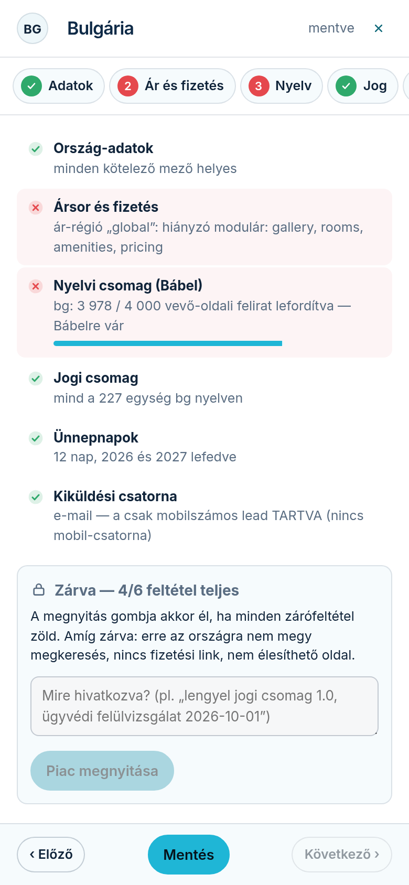
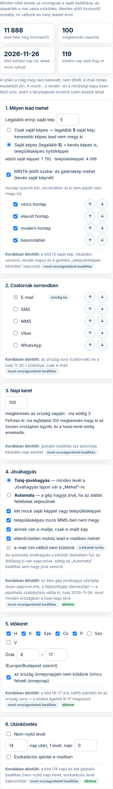
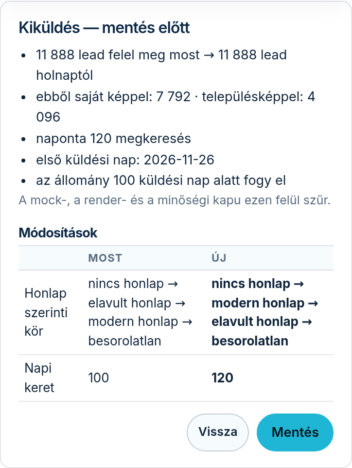
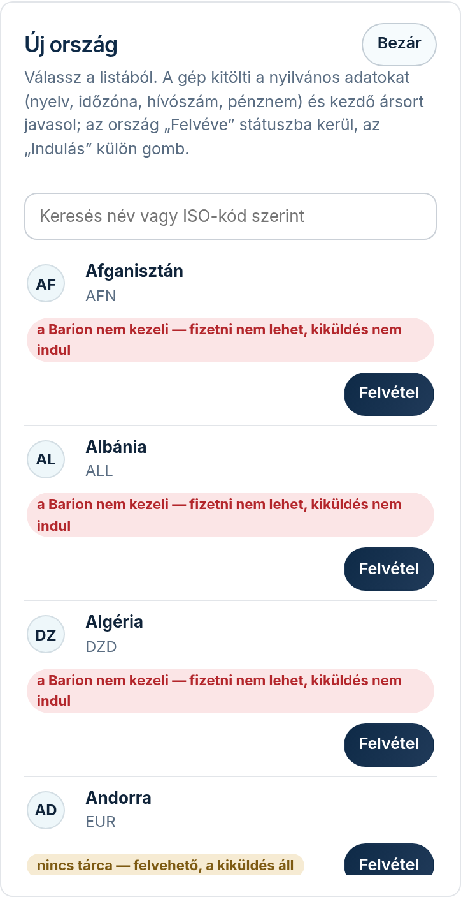

Az **„Országok / Árazás”** lapon (CRM › Országok / Árazás) kezeled az országokat és az áraikat
egy helyen. Ez a korábbi két lapot váltja ki: az **„Árazás és értékesítés”** és az **„Országok”**
lapot. A régi címek (például egy elmentett könyvjelző) ide visznek. Itt veszel fel új országot,
itt látod, hol tart, itt állítod az árát, és itt nézed meg, hogyan megy ki benne a megkeresés.

## A táblázat: egy sor egy ország

Felül négy összesítő szám áll: **„felvett ország”**, **„összes lead”**, **„aktív előfizető”**
(a szüneteltetettek külön, „+” jellel) és **„ma kiküldve / napi keret”**. Ha az automata kiküldés
főkapcsolója ki van kapcsolva, alatta piros sáv mondja ki, hogy egyik országban sem megy ki megkeresés.

A táblázat oszlopai:

- **„Ország”** és **„Pénznem”**;
- **„Árazás”**: **„kész”**, ha az ország ársora teljes; **„hiányos”**, ha valamelyik ár hiányzik
  (asztalon az egeret fölé víve látod, melyik; telefonon a kártya **„Következő:”** sora mondja meg, ha
  ez az első hiány; az ország „Árazás” fülén mindig ott a teljes lista). Hiányos ársorral rendelés nem jön létre;
- **„Státusz”**: **„Felvéve”** (az ország fel van véve, de még nem indult el) → **„Indulás”** (elindítva:
  a gép viszi a leadgyűjtést, de még van hiányzó zárófeltétel, ezért a kiküldés áll) → **„Fut”** (minden
  feltétel teljes, a kiküldés mehet; Magyarországnál **„Fut · hazai”**). Mellette **„Szünetel”**: kézzel
  megállítva — ilyenkor a leadgyűjtés és a kiküldés áll, a meglévő előfizetők megújulása megy tovább;
- **„Leadgyűjtés”** és **„Kiküldés”**: **„megy”**, **„áll”** vagy **„nem indult”**. A leadgyűjtés
  akkor megy, ha az országot elindítottad (**„Indulás”**), nem szünetel, és a gép még járja a csempéit; a
  kiküldés akkor, ha a piac fut (minden zárófeltétel teljes), az automata kiküldés be van kapcsolva, és az
  országnak van napi kerete;
- **„Lead”**, **„Előfizető”**, **„Napi keret”**, **„Ma kiküldve”** (az ország saját napján).

Egy sorra kattintva megnyílik az ország. Telefonon a sorok helyett kártyák vannak, rajtuk a
**következő teendő**: az első hiányzó feltétel. A táblázat alatti sor szerint a **„Globális”** ársor nem
ország: a bejelentkezés nélküli főoldal-látogató ezt látja. Ezt a **„Globális ársor szerkesztése”**
linkről szerkeszted. Ha van olyan ország, amellyel már találkoztunk (van hozzá terület vagy vevő), de
még nincs sora, az is ott áll a táblázat alatt; rákattintva felveheted.

## Egy ország: három fül

- **„Ország”**: az **„Alapadatok”** (státusz, pénznem, ár-régió, nyelv, időzóna, hívószám, fizetés,
  csatorna, kiküldési ablak, napi keret, lead és előfizető), mellette az **„Indítás”** doboz (**„Indulás”**, **„Szüneteltetés”**,
  **„Folytatás”**), alatta **„Az indulás állapota”**: minden feltétel és a lánc minden lépése
  sorrendben (régió-felbontás, csempék, felderítés, lead, kontakt, mock, kiküldés). Ami nem kész, annál
  ott áll: **„Mi hiányzik, ki pótolja:”**. Ember csak két helyen kell: a kezdő ár jóváhagyásánál és a
  fizetési tárca megnyitásánál, mindkettő a tulaj döntése. A többit a gép vagy egy munkatárs (például
  Bábel, a fordító) végzi. Az **„Adatok szerkesztése”** link (a doboz jobb felső sarkában) nyitja meg az ország adatainak szerkesztőjét.
- **„Árazás”**: az ország ársora. Ugyanaz az űrlap, ami korábban az „Árazás és értékesítés” lapon
  volt (csomagok, modulok, alapdíj, saját domain, ajánlatok és próba); a részleteit külön súgó írja le.
  Ha több ország ugyanazt az ársort használja, a fül kiírja, melyek, mert a módosítás náluk is érvényes.
- **„Kiküldés”**: hogyan megy ki a megkeresés ebben az országban — itt **állítod** országonként. Az
  alapérték a korábbi működés, tehát amíg nem nyúlsz hozzá, semmi nem változik. Részletesen lent, a
  „Kiküldés fül” résznél.

## A Kiküldés fül

Felül négy szám: **„lead felel meg (holnaptól)”** (a még meg nem keresett, nem tiltott, e-mail címes
leadek, a mostani beállítással), **„megkeresés naponta”**, **„első küldési nap”** és **„küldési nap alatt
fogy el”**. Amit átírsz, azt a számok azonnal követik. A mock-, a render- és a minőségi kapu ezen felül
szűr, ezért a ténylegesen kimenő szám kisebb lehet.

Alatta hat szakasz:

1. **„Milyen lead mehet”**: a **„Legalább ennyi saját kép”** szám, és egy választó: **csak saját képes**
   (a kevesebb képes lead nem megy ki), vagy **saját képes + kevés képes is, településképes
   nyitóképpel**. Alatta látod a bontást: *„ebből saját képpel: … · településképpel: …”*. Itt dől el az is,
   hogy a MINTA-jelölt szoba- és galériakép mehet-e, és hogy a honlap szerinti körök (nincs honlap,
   elavult, modern, besorolatlan) milyen sorrendben menjenek. A sorrendet a ↑ ↓ gombokkal állítod; a ki
   nem pipált kör nem megy ki.
2. **„Csatornák sorrendben”**: csak az az ország adataiban élő csatorna kapcsolható be, a többi
   **„nem él”**. Az e-mail be van zárva, nem vehető ki: a kiküldő ma csak e-mailt küld. Egy bekapcsolt
   SMS, MMS, Viber vagy WhatsApp ma **semmit nem küld**, mert az „e-mail cím nélkül nem küldünk” szabály
   él. A lap ezt sárgán ki is írja, amint egy mobilcsatornát bepipálsz.
3. **„Napi keret”**: hány megkeresés megy ki naponta az ország saját napján. Ha a felfutás él, a
   hazai keret a felfutás napi plafonjáig emelkedik, és ezt a szakasz ki is írja.
4. **„Jóváhagyás”**: **„Tulaj-jóváhagyás”** (minden levél a Jóváhagyás lapon vár a „Mehet”-re), vagy
   **„Automata”** (a gép hagyja jóvá, ha a pipált feltételek teljesülnek). Az alapérték minden
   országban a tulaj-jóváhagyás. Az öt feltétel:
   - **„két mock saját képpel vagy településképpel”** — csak az mehet, akinek mindkét terve a szállás
     saját képeivel (vagy a település képével) készült;
   - **„településképes mock MMS-ben nem megy”** — a település képével készült terv nem mehet képes
     üzenetben (MMS), csak más csatornán (a tulaj szabálya, 2026-11-12);
   - **„akinek van e-mailje, csak e-mailt kap”** — e-mail címes leadnek nem megy mobilüzenet;
   - **„ellenőrizetlen mobilú lead e-mailben mehet”** — ha a mobilszámát még nem ellenőriztük, az
     e-mail nem vár erre;
   - **„e-mail cím nélkül nem küldünk”** — e-mail cím nélkül semmi nem megy ki. Ez a feltétel nem vehető ki: ezt a
     kiküldő maga tartja.

   ⚠️ Az „Automata” csak akkor hagy jóvá bármit, ha az automata jóváhagyás
   főkapcsolója be van kapcsolva (a kiküldő ütemében fut, 20 percenként). Ezt nem ezen a lapon kapcsolják,
   hanem az élesítéskor, egyszer, minden országra. Amíg ki van kapcsolva, a szakasz alja ezt kiírja
   (*„… addig az »Automata« beállítás sem hagy jóvá semmit”*), és minden levél a Jóváhagyás lapon vár.
5. **„Időkeret”**: a hét napjai, az órák az ország időzónájában, és hogy az ünnepnapokon szünet van-e.
6. **„Utánkövetés”**: a **„Nem-nyitó levél”** be-ki kapcsolója, hány nap után megy, és a napi kerete.
   Ha be van kapcsolva, de a kerete 0, a lap figyelmeztet, mert így egy sem megy ki. Itt kapcsolod az
   **„Eszkalációs ajánlat e-mailben”** levelet is.

Minden szakasz alján ott áll, mi döntött róla korábban (a kód vagy egy globális beállítás). A
**„döntve”** jel azt mutatja, amiről a tulaj már döntött. Ha módosítasz, alul megjelenik egy sáv:
*„… módosítás — még nincs mentve”*, mellette a **„Visszaállítás”** (eldobja a még nem mentett
módosításokat, és a fül a mentett állapotot mutatja újra) és a **„Mentés…”** gomb. A
„Mentés…” előbb egy összesítőt nyit: hány lead felel meg most és holnaptól, naponta hány megkeresés
megy, mikor az első küldési nap, és a módosítások listája (*Most → Új*). Csak ott, a **„Mentés”**
gombbal kerül a beállítás az országra. Hibás mezőnél (például ha egy nap sincs bepipálva) a lap nem ment.

## Új ország felvétele

1. Koppints az **„Új ország”** gombra a cím alatt. Megnyílik a világ országainak listája.
2. Keress név vagy ISO-kód szerint (**„Keresés név vagy ISO-kód szerint”**). Minden sorban látod az
   ország nevét, a **hivatalos pénznemét**, és a Barion-jelzést:
   - zöld **„van tárca”** — a vevő fizetni tud;
   - sárga **„nincs tárca — felvehető, a kiküldés áll”** — a Barion kezeli a pénznemet, de a mi fiókunkban
     még nincs hozzá pénztárca (ezt a tulaj nyitja meg);
   - piros **„a Barion nem kezeli — fizetni nem lehet, kiküldés nem indul”**.

   A már felvett ország halványan látszik (**„már felvéve”**), nem választható.
3. Koppints a **„Felvétel”** gombra. A gép kitölti a nyilvános adatokat (alapnyelv, időzóna, hívószám,
   belföldi előtag, pénznem, a név magyarul), és létrehozza az ország **saját ár-régióját** a hivatalos
   pénznemével. Kezdő ársort is javasol: a globális (euró) ársort a napi MNB-árfolyammal átváltja, és
   kerek végződésre igazítja. A javaslat **jóváhagyatlan**: amíg a tulaj az Árazás fülön jóvá nem hagyja, az
   ország teljességében a „Ársor és fizetés” sor piros. Az euróövezetben a pénznem **EUR** — Bulgáriában is,
   2026. január 1. óta (BGN-t a lap nem fogad el).
4. Megnyílik az adatok szerkesztője. Töltsd ki a hiányzó mezőket a négy fülön: **„Azonosság és pénz”**,
   **„Felderítés”**, **„Telefonszám-szabály”**, **„Jog”** (a felderítés területét és keresőszavait a nyilvános
   adatokból nem lehet tudni). A fülön látod, hány mező hibás; a hiba a mező alatt jelenik meg.
5. Koppints az **„Ország felvétele”** gombra. Ha még van hibás mező, a lap nem ment, és a hibás mező helyére
   ugrik. Mentés után az ország **„Felvéve”** státuszú. Az **„Indulás”** külön gomb (lásd lent).

Ünnepnapot a gép nem talál ki: EU-n kívüli országnál az ünnepnap-lista üresen indul, és a teljesség ezt
pirosan jelzi, amíg valaki fel nem veszi.

## Az adatok szerkesztője

Az ország **„Ország”** fülén az **„Adatok szerkesztése”** link nyitja meg. A panel tetején hat lépés van: **„Adatok”** → **„Ár és fizetés”** → **„Nyelv”** → **„Jog”** →
**„Megkeresés”** → **„Megnyitás”**. A lépés színe a lépés állapota, és írás közben frissül.

- **Gyűjtő-lánc szótára** (az „Adatok” lépésben, külön sorban). Az elindított országban a gép ember
  nélkül keres szállásokat, és ehhez az ország szótára kell: a területei és a keresőszavai. Ha
  megvan, a sor zöld, és kiírja, hány területet fog bejárni (*„21 terület a felderítéshez”*). Ha
  nincs, a sor sárga: *„nincs országszótár … — a felderítés és a kontaktkereső nem tud ezen az
  országon dolgozni”*. Akkor is sárga, ha a szótár megvan, de nincs benne terület: *„a szótárban
  nincs terület (subdivisions) — a felderítés nem tudja, mit járjon be”*. Ez nem zár: az ország a
  szótár nélkül is futhat (próba és fizetés megy), csak a gép nem gyűjt ott leadet. Neked itt
  nincs teendőd: a szótárat a fejlesztés készíti el az ország felvételekor, és amint elkészül, a sor
  magától zöldre vált.
- **Ár és fizetés.** Az ország ár-régiójának teljes ársora kell, és a fizetési szolgáltatónak
  fogadnia kell az ország pénznemét. Hiányos ársornál a vendég foglalási kérése is elhasalna,
  ezért ez zárófeltétel. Az árakat az ország **„Árazás”** fülén töltöd ki; a régiót és a pénznemet az
  „Adatok” lépésben választod. Nem EU-s ország ebben a körben nem nyitható (a számlázása nincs megoldva).
- **Fizetési tárca** (ugyanebben a lépésben, külön sorban). Hiába fogadja a szolgáltató a pénznemet,
  ha a mi fiókunkban nincs hozzá pénztárca, a vevő pénze nem tud megérkezni. Ez is zárófeltétel.
  Ha hiányzik, a sor piros, és ezt írja: *„nincs EUR pénztárca a barion fiókban — EUR fizetés addig
  nem fogadható; a tárca nyitása a tulaj döntése”* (az ország pénznemével és szolgáltatójával).
  Ezt itt nem tudod megoldani: szólj a tulajnak, ő nyitja meg a tárcát a szolgáltatónál. Ha megvan,
  a sor zöld: *„EUR pénztárca megvan (barion)”*.
- **Nyelv.** Megkeresés, mock és vendégoldal csak az ország alapnyelvén megy. A lap a
  vevő-oldali feliratokat számolja (a konzol saját feliratai nem számítanak, azok magyarul
  maradnak). Ha valami hiányzik, a sor sárga, de nem zár: a piac nyitva marad. Csak az az egy
  levél vagy mock vár („Bábelre vár”), amelynek a saját szövegéből hiányzik a fordítás — a többi
  megy. Neked nincs teendőd: a fordítást Bábel végzi, itt csak a teljességet látod. Zár csak
  akkor, ha az országnak nincs alapnyelve.
- **Jog.** Az ország jogi csomagja az ország nyelvén (ÁSZF, elállás, adatkezelés, DPA,
  impresszum, süti, a megkeresés jogi bekezdése, leiratkozó). Franciaországban és
  Portugáliában a **„Fogyasztói vitarendező”** is megjelenik: ha nincs beállítva,
  magánszemélynek nem adható el, cégnek igen — ezért ez sárga, nem zár.
- **Megkeresés.** **„Csatornák”**, **„Küldési ablak (helyi idő)”**, **„Napi kvóta”** és
  **„Ünnepnapok”**. A „Küldési ablak (helyi idő)” és a „Napi kvóta” ugyanaz az érték, amit az ország
  **„Kiküldés”** fülének **„5. Időkeret”** (órák) és **„3. Napi keret”** szakasza mutat és állít: ha az egyik
  helyen átírod, a másik helyen is az új érték látszik. Az e-mail csatorna kötelező. Az SMS/MMS a magyar SIM-es modemen megy, ezért
  külföldi számra csak helyi mobil-szolgáltatóval menne: amíg nincs, a csak mobilszámos lead
  TARTVA — a lap ezt sárgán jelzi, nem kérdez rá.

## Ünnepnapok

Ünnepnapon a válasz nem megy ki. Válassz napot, és koppints a **„Hozzáad”** gombra. Ha a
**„minden évben”** pipa be van jelölve, a nap minden évben ismétlődik (például január 1.). A
mozgó ünnepeket (húsvét, pünkösd) évenként külön kell felvenni: vedd ki a pipát, ilyenkor a
nap csak abban az évben érvényes, és szaggatott keretet kap. A lap az aktuális és a következő
évet nézi: ha bármelyik **„hiányzik”**, az országból nem mehet ki megkeresés. Évváltáskor a lap egy évvel előrébb
lép, tehát a jövő évi mozgó ünnepeket még az év vége előtt vedd fel, különben a futó ország január 1-jén
hiányossá válik, és a kiküldés leáll. Magyarországnál az üres lista csak figyelmeztetés (a hazai ütemezés eddig sem ismert ünnepnapot).

## Indulás, szüneteltetés, folytatás

Az ország **„Ország”** fülének **„Indítás”** dobozában (és a szerkesztő **„Megnyitás”** lépésében):

- **„Felvéve — indítható”**: az **„Indulás”** gomb elindítja az országot. Ehhez **nem kell**, hogy minden
  zárófeltétel zöld legyen: az indulás után a gép magától viszi végig a régió → felderítés → kontakt → mock →
  kiküldés sort, a **kiküldés** viszont csak akkor indul, ha minden zárófeltétel zöld. Ami még hiányzik, azt a
  doboz felsorolja.
- **„Indulás — a gép viszi”**: elindítva, de még hiányzik valami a kiküldéshez (a lista ott áll). Ha minden
  zöld, a doboz **„Fut”**-ra vált.
- **„Szüneteltetés”** (a doboz alján lenyitható): megállítja az országot. A leadgyűjtés és a kiküldés áll,
  új rendelés és élesítés nem indul; a meglévő előfizetők megújulása megy tovább. A hazai piac (HU) nem
  szüneteltethető — a szerver is elutasítja.
- **„Szünetel”**: a **„Folytatás”** gomb újraindítja (ha minden zárófeltétel zöld, újra **„Fut”**).

Az ország MENTETT sorára vonatkozik: nem mentett szerkesztésnél a doboz ezt kéri: „Előbb mentsd az országot”.

Amíg egy ország nem fut (vagy szünetel), a rendszer magától megáll: **hideg megkeresés** nem megy ki (a levél
és az SMS a küldés előtti ellenőrzésen `PIAC:` jelöléssel bukik — ha ezt látod egy lead naplójában, az ország nem
fut, és itt derül ki, miért), **fizetési link** nem adható ki, a megrendelt oldal **nem kapcsol élesre**. A már
futó előfizetések megújulása és a már élő oldalak kiszolgálása szándékosan megy tovább.

Miért ország, és nem nyelv? Mert a jogi csomag jogrendszerhez tartozik: Ausztria és
Németország ugyanazt a nyelvet beszéli, de más a szabályozásuk.

## Napló

Minden döntés megmarad a doboz alján: időpont, a bejelentkezett operátor neve és a művelet (**„elindítva /
megnyitva”**, **„szüneteltetve”**, **„folytatva”**, **„lezárva”**) — így a „miért fut / áll ez az ország?”
kérdés hónapokkal később is megválaszolható.
