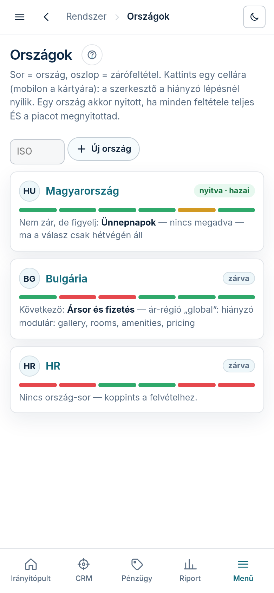

A **„Országok”** lapon (Rendszer › Országok) kezeled az országokat: itt veszel fel egy új
országot, itt írod át az adatait (nyelv, időzóna, pénznem, ár-régió, telefonszám-szabály,
csatornák, küldési ablak, kvóta, ünnepnapok), és itt látod egy helyen, mi hiányzik még ahhoz,
hogy az országban dolgozhassunk. A piacot is itt nyitod meg — ez korábban a Beállítások lap
„Piacok — jogi csomag” paneljén volt.

## A mátrix: egy sor egy ország

Minden sor egy ország, minden oszlop egy **zárófeltétel**: **„Adatok”**, **„Ár”**, **„Nyelv”**,
**„Jog”**, **„Ünnep”**, **„Csatorna”**. A zöld pipa rendben van, a piros X hiányzik, a sárga
felkiáltójel nem zár, de figyelni kell rá. Az utolsó oszlop a **„Piac”** állapota:

- **„nyitva · hazai”** — Magyarország, a termék erre a jogra készült;
- **„nyitva”** — a piacot megnyitottad, és minden feltétele teljes;
- **„jóváhagyva, hiányos”** — megnyitottad, de azóta hiányos lett: ilyenkor a piac ZÁRVA tart, amíg a piros
  pont meg nem lesz. A leggyakoribb ok az **évváltás**: január 1-jén a lap már a következő évet is nézi, és ha
  annak mozgó ünnepei (húsvét, pünkösd) nincsenek felvéve, a nyitott piac magától hiányos lesz, és leáll a
  megkeresés. Ezért **év vége előtt vedd fel a jövő évi mozgó ünnepeket**. Másik ok: kijött egy új vevő-oldali
  felirat, amit Bábel még nem fordított;
- **„megnyitható”** — minden feltétel teljes, csak a jóváhagyásod hiányzik;
- **„zárva”** — még van piros feltétel.

Bármelyik cellára kattintasz, a jobb oldali panel **pont annál a lépésnél** nyílik. Telefonon a
sorok helyett kártyák vannak: a hatrészes csík ugyanezt a hat feltételt mutatja, alatta a
**következő teendő**. A lista azokat az országokat is mutatja, **amelyekkel már találkoztunk**
(van hozzá terület vagy vevő), de még nincs soruk — ezekre koppintva veszed fel őket.

## Új ország felvétele

1. Írd be a kétbetűs ISO-kódot (például `HR`) a mátrix fölötti mezőbe, és koppints az
   **„Új ország”** gombra.
2. Az EU-tagoknál a nyilvános tények már ki vannak töltve: alapnyelv, időzóna, hívószám,
   belföldi előtag és pénznem. Az euróövezetben a pénznem **EUR** — Bulgáriában is, 2026.
   január 1. óta (BGN-t a lap nem fogad el).
3. Töltsd ki a hiányzó mezőket a négy fülön: **„Azonosság és pénz”**, **„Felderítés”**,
   **„Telefonszám-szabály”**, **„Jog”**. A fülön látod, hány mező hibás; a hiba a mező alatt
   jelenik meg, amint hozzányúltál (egy friss sor nem piros fal).
4. Koppints az **„Ország felvétele”** gombra. Ha még van hibás mező, a lap nem ment, és a
   hibás mező helyére ugrik.

## A lépések

A panel tetején hat lépés van: **„Adatok”** → **„Ár és fizetés”** → **„Nyelv”** → **„Jog”** →
**„Megkeresés”** → **„Megnyitás”**. A lépés színe a lépés állapota, és írás közben frissül.

- **Gyűjtő-lánc szótára** (az „Adatok” lépésben, külön sorban). A megnyitott piacon a gép ember
  nélkül keres szállásokat, és ehhez az ország szótára kell: a területei és a keresőszavai. Ha
  megvan, a sor zöld, és kiírja, hány területet fog bejárni (*„21 terület a felderítéshez”*). Ha
  nincs, a sor sárga: *„nincs országszótár … — a felderítés és a kontaktkereső nem tud ezen az
  országon dolgozni”*. Ez nem zár: a piac a szótár nélkül is megnyitható (próba és fizetés megy),
  csak a gép nem gyűjt ott leadet, amíg a szótár el nem készül.
- **Ár és fizetés.** Az ország ár-régiójának teljes ársora kell, és a fizetési szolgáltatónak
  fogadnia kell az ország pénznemét. Hiányos ársornál a vendég foglalási kérése is elhasalna,
  ezért ez zárófeltétel. Az árakat az **Árazás** lapon töltöd ki; a régiót és a pénznemet az
  „Adatok” lépésben választod. Nem EU-s ország ebben a körben nem nyitható (a számlázása nincs megoldva).
- **Fizetési tárca** (ugyanebben a lépésben, külön sorban). Hiába fogadja a szolgáltató a pénznemet,
  ha a mi fiókunkban nincs hozzá pénztárca, a vevő pénze nem tud megérkezni. Ez is zárófeltétel.
  Ha hiányzik, a sor piros, és ezt írja: *„nincs EUR pénztárca a barion fiókban — EUR fizetés addig
  nem fogadható; a tárca nyitása a tulaj döntése”* (az ország pénznemével és szolgáltatójával).
  Ezt itt nem tudod megoldani: szólj a tulajnak, ő nyitja meg a tárcát a szolgáltatónál. Ha megvan,
  a sor zöld: *„EUR pénztárca megvan (barion)”*.
- **Nyelv.** Megkeresés, mock és vendégoldal csak az ország alapnyelvén megy. A lap a
  vevő-oldali feliratokat számolja (a konzol saját feliratai nem számítanak, azok magyarul
  maradnak). Ha egy is hiányzik, a megkeresés TARTVA („Bábelre vár”). A fordítást Bábel végzi
  — itt csak a teljességet látod.
- **Jog.** Az ország jogi csomagja az ország nyelvén (ÁSZF, elállás, adatkezelés, DPA,
  impresszum, süti, a megkeresés jogi bekezdése, leiratkozó). Franciaországban és
  Portugáliában a **„Fogyasztói vitarendező”** is megjelenik: ha nincs beállítva,
  magánszemélynek nem adható el, cégnek igen — ezért ez sárga, nem zár.
- **Megkeresés.** **„Csatornák”**, **„Küldési ablak (helyi idő)”**, **„Napi kvóta”** és
  **„Ünnepnapok”**. Az e-mail csatorna kötelező. Az SMS/MMS a magyar SIM-es modemen megy, ezért
  külföldi számra csak helyi mobil-szolgáltatóval menne: amíg nincs, a csak mobilszámos lead
  TARTVA — a lap ezt sárgán jelzi, nem kérdez rá.

## Ünnepnapok

Ünnepnapon a válasz nem megy ki. Válassz napot, és koppints a **„Hozzáad”** gombra. Ha a
**„minden évben”** pipa be van jelölve, a nap minden évben ismétlődik (például január 1.). A
mozgó ünnepeket (húsvét, pünkösd) évenként külön kell felvenni: vedd ki a pipát, ilyenkor a
nap csak abban az évben érvényes, és szaggatott keretet kap. A lap az aktuális és a következő
évet nézi: ha bármelyik **„hiányzik”**, az ország nem nyitható. Évváltáskor a lap egy évvel előrébb
lép, tehát a jövő évi mozgó ünnepeket még az év vége előtt vedd fel, különben a nyitott piac január 1-jén
hiányossá válik. Magyarországnál az üres lista csak figyelmeztetés (a hazai ütemezés eddig sem ismert ünnepnapot).

## A piac megnyitása

A **„Megnyitás”** lépés felsorolja az összes feltételt. A **„Piac megnyitása”** gomb csak akkor
él, ha minden zárófeltétel zöld, és az ország MENTVE van (nem mentett szerkesztésnél
„Előbb mentsd az országot”). A szerver a gombnyomáskor újra megnézi a teljességet.

A megnyitás felelősségvállalás: kijelented, hogy az ország jogi csomagja kész és felülvizsgált. Nézd meg a
megkeresés szabályait is: több országban a hideg megkereséshez **opt-in** kell, nem elég a jogos érdek.
Az indoklás mezőbe írd be, **mire hivatkozva** nyitod meg (például melyik csomag melyik
verziója, ki vizsgálta felül). Az indoklás **kötelező**: nélküle nem történik semmi, és naplósor
sem keletkezik.

Zárt országnál a rendszer magától megáll: **hideg megkeresés** nem megy ki (a levél és az SMS a küldés
előtti ellenőrzésen `PIAC:` jelöléssel bukik — ha ezt látod egy lead naplójában, az ország zárva van, és itt
derül ki, miért), **fizetési link**
nem adható ki, a megrendelt oldal **nem kapcsol élesre**. Szabadon mehet a lead begyűjtése, a
mock legyártása és a mintaoldal megmutatása. Zárt piacon is működik, szándékosan, a már futó
előfizetések megújulása és a már élő oldalak kiszolgálása.

Miért ország, és nem nyelv? Mert a jogi csomag jogrendszerhez tartozik: Ausztria és
Németország ugyanazt a nyelvet beszéli, de más a szabályozásuk.

## Lezárás és napló

A nyitott ország **„Megnyitás”** lépésében:

1. nyisd le a **„Piac lezárása”** sort;
2. írd be az indoklást (kötelező, legalább 3 karakter);
3. koppints a **„Lezárás”** gombra.

A lezárás a jövőre hat: új megkeresés, új rendelés és élesítés nem indul. A hazai piac (HU) innen nem zárható le. Minden döntés megmarad a blokk alján: időpont, a bejelentkezett
operátor neve, a művelet és az indoklás — így a „miért van ez a piac nyitva?” kérdés hónapokkal
később is megválaszolható.
