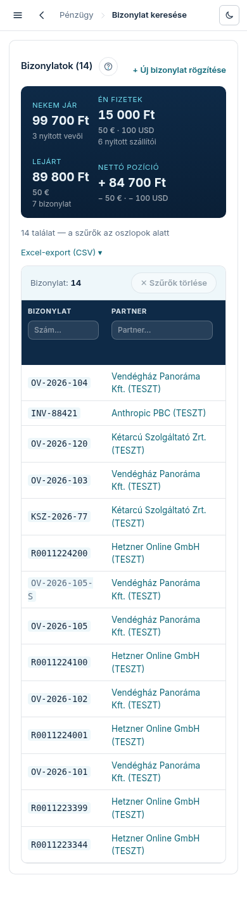

A **„Bizonylatok”** menüpont a cég ÖSSZES bizonylatát mutatja egyetlen táblában — kimenő és
bejövő nincs külön szekcióra szedve: az irány csak szűrő, és nem külön oszlop (a **„Vevői számla”**
/ **„Szállítói számla”** típus úgyis megmondja, be- vagy kimenő-e). Így egy kereséssel megtalál
bármit, akárhonnan jött.

## A felső sáv — hol áll a pénz

A táblázat fölött négy szám, pénznemenként külön bontva (soha nem összeadva): mennyi **jár nekem**
(a még ki nem egyenlített vevői számlák), mennyit **fizetek** (a nyitott szállítói számlák), mennyi
a **lejárt**, és a **nettó pozíció** (a kettő különbsége). Ha több devizában is van tétel, a fő
összeg alatt kisebb sorban jelennek meg a többiek (pl. EUR, USD).

## Keresés és szűrés — az oszlopok alatt

A szűrők közvetlenül a táblázat sötét fejlécében ülnek, oszloponként: a **„Szám…”** mezőbe a
bizonylatszám, a **„Partner…”** mezőbe a név töredéke; a Típus lenyílója a fajtára szűr, alatta egy
második lenyíló a forrásra (**„minden forrás”** / **„rendszer-számla”** / **„kézi / importált”** — lásd lent); a Kelte és
a **„Fiz. határidő”** alatt egy-egy tól–ig dátumpár (két naptár-mező: mettől meddig); a **„Pénznem”**
és az Állapot (fizetve / nyitott) szintén lenyíló. A szűrés a szerveren fut, tehát akkor is a teljes
adatbázisból keres, ha az több ezer sor. A lenyílók és a dátumok választásra azonnal szűrnek, a
szöveg-mezők gépelés után maguktól; minden aktív szűrő egy kis címkeként (chip) is megjelenik a
táblázat tetején, egyenként törölhető ✕-szel, vagy mind egyszerre a **„Szűrők törlése”** gombbal.
A letöltés mindig a szűrt listát adja (**„Excel-export (CSV) ▾”**).

## Lapozás — és amit fontos tudni róla

Egy oldalon 50 bizonylat fér el; a táblázat alján lapozó jelenik meg (**„Előző”** / oldalszámok /
**„Következő”**), mellette a tartomány: pl. „101–150 / 214 tétel”. Ha csak egy oldalnyi találat
van, a lapozó nem is látszik.

Két dolog szándékosan NEM az oldalra vonatkozik, hanem mindig a teljes szűrt listára: a felső sáv
négy száma (tehát a kintlévőség nem az 50 soré, hanem az összesé — kivéve a sztornózott és a
„számla nem készült” rendszer-sorokat, lásd lent), és az Excel-export, ami akkor
is minden találatot letölt, ha épp a 3. oldalt nézi. Szűréskor a lista mindig visszaugrik az első
oldalra — így nem marad egy már nem létező oldalon.

## Mit mutat a tábla?

Bizonylatszám · Partner (a nevére kattintva a partner-lapra ugrik) · Típus · Kelte ·
**„Fiz. határidő”** · **„Esedékesség”** (ebből számolt emberi olvasat: „3 nap múlva” vagy
„9 napja lejárt”) · Nettó · Bruttó · **„Pénznem”** · Állapot · **„Számlakép ▸”** (a tárolt
bizonylat-kép, ha van; a rendszer-számlánál a számlázótól kapott PDF). A sztornó negatív összeggel,
halványan jelenik meg ugyanabban a listában. Az Excel-exportban egy külön „Forrás” oszlop is van
(kézi, importált, rendszer, illetve rendszer — sztornózva / sikertelen / visszavonva).

## Rendszer-számlák — amit a fizetésből mi magunk állítunk ki

Amikor egy vevő fizet (rendelés, megújítás), a rendszer automatikusan számlát állít ki, és ez a
számla ide, a Bizonylatok közé is bekerül — nem kell kézzel rögzíteni. A bizonylatszám alatt egy
kis jelvény mutatja, honnan jött és mi lett vele:

- **„rendszer”** — a fizetésből automatikusan kiállított, rendben lévő számla. Ugyanúgy számít,
  mint bármelyik kézzel rögzített vevői számla.
- **„sztornózva”** — a számlát utólag sztornózták. A sor halványan a listában marad, hogy lássa a
  történetet, de az összege NEM számít bele a felső sáv négy számába — mert már nem pénz.
- **„számla nem készült”** — a vevő fizetett, de a számlázó nem állította ki a számlát. Ez sem
  pénz a listában (halvány, nem számít a felső sávba), és szám sincs mellette. Az okot (a számlázó
  hibaüzenetét) a jelvényre mutatva látja számítógépen; telefonon ez nem jelenik meg, ezért ilyenkor
  nézze meg gépről. Erről a ház-riasztás is szól. Ha a számla később elkészül, ez a sor magától
  eltűnik, és a helyén a kiállított számla jelenik meg **„rendszer”** jelvénnyel — ha nem tűnik el,
  a számlázási hibát ki kell vizsgálni.

A forrás-lenyílóval csak a rendszer-számlákat (**„rendszer-számla”**) vagy csak a kézzel rögzített és
importált bizonylatokat (**„kézi / importált”**) is kiszűrheti.
