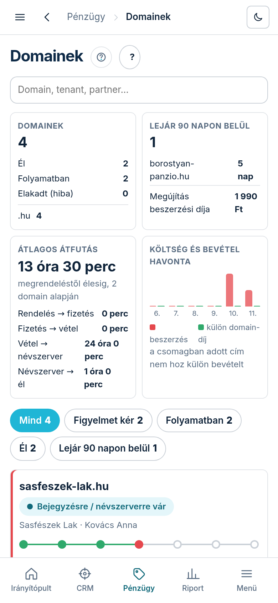

A Domainek lap arra felel, milyen webcímeket vettünk a vevőknek (és a saját címeinket), hol tart
mindegyik a vételtől a beköltözésig, mikor jár le, ki fizeti, és melyikre kell ránézni.

## Hol találod

A bal menüben **„Pénzügy”** → **„Domainek”**. A partner-lap **„Domain”** füle ugyanennek a
nyilvántartásnak az adott partnerre szűrt nézete.

## Mit mutat

- **Csempék** felül: **„Domainek”** (hány van összesen; ebből **„Él”**, **„Folyamatban”**,
  **„Elakadt (hiba)”**, és végződésenként), **„Lejár 90 napon belül”** (a három legközelebbi és a
  **„Megújítás beszerzési díja”**), **„Átlagos átfutás”** (megrendeléstől élesig, lépésenként:
  **„Rendelés → fizetés”**, **„Fizetés → vétel”**, **„Vétel → névszerver”**, **„Névszerver → él”**),
  és **„Költség és bevétel havonta”** (a beszerzés és a külön domain-díj hónaponként; a csomagban
  adott cím nem hoz külön bevételt).
- **Szűrők**: **„Mind”**, **„Figyelmet kér”**, **„Folyamatban”**, **„Él”**, **„Lejár 90 napon
  belül”** — mindegyik mellett a darabszám. A keresőbe domaint, tenantot vagy partnert írhatsz,
  a lista gépelés közben szűkül.
- **Tábla** (telefonon kártyák): **„Domain”**, **„Tenant · partner”**, **„Életút”**, **„Lejárat”**,
  **„Fedezet”**, **„Regisztrátor”**. A **„SAJÁT”** jel a saját címeinket jelöli. A domain, a
  tenant és a lejárat oszlop fejlécére koppintva rendez.
- **Életút-sáv** — hét lépés: **„Rendelés”** → **„Fizetés”** → **„Vétel”** → **„Megerősítés”**
  (csak .hu: a Nyilvántartó megerősítése) → **„Névszerver”** → **„TLS”** → **„Él”**. Alatta az
  állapot (pl. **„Bejegyzésre / névszerverre vár”**, **„Él”**, **„Elakadt (hiba)”**), és ha vár,
  hogy mióta: 24 óra után riasztás megy, 72 óra után a vevő is levelet kap.
- **Figyelmet kér** (piros szegély): elakadt vagy hibás vétel, 60 napon belül lejáró cím,
  megújítási gond, vagy megszűnt előfizetés mellett még élő cím.

## Az adatlap (oldalfiók)

Egy sorra vagy kártyára koppintva jobbról becsúszik a domain adatlapja (a link meg is osztható,
ugyanígy nyílik): felül az életút-sáv, alatta az **„Életút”** idővonala a mért időpontokkal —
ahol nincs mért idő, ott **„nincs adat”** áll, nem találunk ki időt —, a **„Lejárat és
megújítás”** (lejárat, automatikus megújítás, **„Következő megújítás”**, **„Megújítás díja”**),
a **„Fedezet”** (**„csomagban”**, **„havidíj”** vagy **„kivásárolta”**), a **„Kié, mi
alapján”** (tenant, partner, oldal, megrendelés, regisztrátor-azonosító) és a regisztrátor
üzenete, ha írt. A **„Bezárás”** gomb vagy az Esc zárja.

A cím melletti súgó-ikon ezt a leírást nyitja; a mellette lévő **„?”** egy rövid magyarázatot ad a lapon belül.
