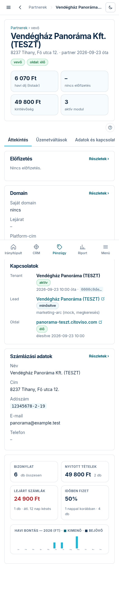
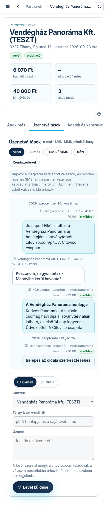
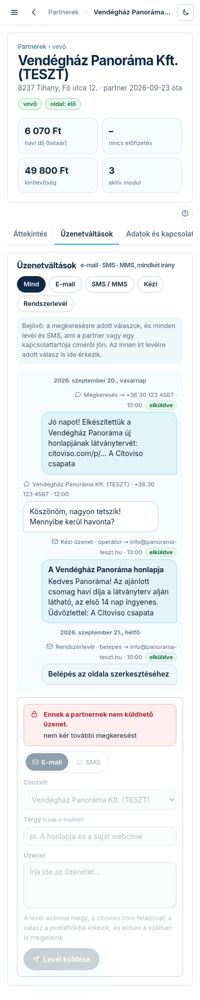

A partner nevére kattintva (a **„Partnerek”** listából) nyílik a partner-lap: egy vevő vagy
szállító minden adata egy helyen — kicsoda, mit fizet, mi a domainje, mi vár rá, és mi történt
vele. A vevő marketing-oldala (mock, megkeresés) a lead-lapon marad; az **„Áttekintés”** fül
„Kapcsolatok” kártyáján a lead neve oda visz át.

## A fejléc

A számlázási név alatt a cím és az, hogy mióta partnerünk. A jelvények: vevő és/vagy szállító,
az előfizetés állapota, az oldal állapota és a saját domain állapota (amelyik van).

A csempék vevőnél: **„havi díj (listaár)”** (a bekapcsolt modulokból), **„következő
terhelés”** (dátum, az összeg és a mentett kártya — ugyanaz az összeg, amit a vevő a saját
adminjában lát; az első fizetés megkeresési kedvezménye nem újul meg), **„kintlévőség”** és
**„aktív modul”**. Szállítónál: **„éves költség”** és **„tartozásunk”**. Az összegek devizánként
külön állnak.

## Az **„Áttekintés”** fül

Felül a **„Figyelendő”** lista — csak az, ami figyelmet kér: a saját domain a .hu Nyilvántartó
megerősítésére vár vagy beállítás alatt van; a domain lejárata még becsült (a napi szinkron még
nem olvasta le a regisztrátortól); elmaradt fizetés, befagyasztás, lemondás; a mentett kártya
lejár a következő terhelés előtt; a partneren nincs telefonszám, de a leadben van. Ez utóbbinál
az **„Átveszem a partnerre”** link megnyitja a szerkesztőt a számmal kitöltve — semmi nem
íródik, amíg nem nyomja meg a **„Mentés”** gombot.

Alatta kártyák: **Előfizetés**, **Domain**, **Kapcsolatok** (tenant, lead, oldal, a tulaj
belépési neve és utolsó jelszavas belépése) és **Számlázási adatok**. A **„Részletek”** link a
megfelelő fülre visz. Legalul a bizonylat-összesítő és a havi bontás.

## Az **„Üzenetváltások”** fül — minden levél és SMS egy szálban, és innen írhat is

Egy szál, időrendben, mint egy csevegés: jobbra a mi üzeneteink (a megkeresés MMS-e, SMS-e és
levele, a válaszainkra adott válasz, a kézi üzenetek, és a rendszerlevelek — számla, belépés,
domain —, ez utóbbiak lenyitható kártyaként), balra a partneré (a megkeresésre adott válasza, és
minden levél vagy SMS, ami a partner vagy egy kapcsolattartója címéről jön). A buborék fölött a
csatorna, a címzett, az időpont és az állapot: **„elküldve”**, **„sorban — a modem-sáv viszi
ki”**, **„ütemezve”** vagy **„nem ment ki”** (ilyenkor mellette az **„újra”** gomb). Ha a
megkeresés Viberen vagy WhatsAppon ment ki (kép és link egy üzenetben, SMS nélkül), a buborék
fölött a feliratot az app neve követi (a Megkeresés felirat mögött: · Viber). A lead ottani
válaszain és a mi arra adott válaszainkon is ott áll az app neve. A sorban álló ilyen válasznál
**„sorban — a telefon beírja a csevegésbe”** látszik: ezt a választ a telefon írja be ugyanabba a
csevegésbe. A fül
neve mellett a szám: hány üzenete jött a partnernek a mi utolsó üzenetünk óta.

Felül a szűrők: **„Mind”**, **„E-mail”**, **„SMS / MMS”**, **„Kézi”**, **„Rendszerlevél”**.

**Írás** (a szál alatt):

- **„E-mail”** / **„SMS”** váltó, **„Címzett”** — csak a partner és a kapcsolattartói címei
  közül (SMS-nél a lead telefonja is, ahová a megkeresés ment). Leiratkozott címre nem küldhet.
- **„Tárgy”** csak levélnél kell. SMS-nél a számláló mutatja a karaktereket és a részeket:
  ékezet nélkül 160 karakter egy SMS, egy ékezet (ő, ű, „) miatt az egész 70-es részekre vált —
  az **„Ékezet nélkül küldöm (kevesebb SMS-rész)”** link leveszi az ékezeteket. 5 résznél
  hosszabb szöveg nem küldhető. Az aláírás („A Citoviso csapata”) alapból a végére kerül.
- **„Levél küldése”** / **„SMS küldése”**: a levél azonnal megy, a citoviso.com feladóval — a
  válasz a postafiókba érkezik, és ebben a szálban is megjelenik. Az SMS a modem-sávon megy ki,
  általában 1 percen belül; este 10 és reggel 7 között reggel 7-kor. A kiküldött üzenet azonnal
  megjelenik a szálban, és az SMS állapota magától frissül.
- A vevő a saját adminjában, az üzenetei között is látja, amit innen írt neki.

**Ha a partner elutasító vagy leiratkozott**, az írás-doboz fölött piros sáv áll: **„Ennek a
partnernek nem küldhető üzenet.”**, az okkal együtt, és a doboz le van tiltva. Az elutasító-jelet
az Irányítópult „Válaszok a megkeresésekre” blokkjában lehet feltenni.

## Az **„Adatok és kapcsolattartók”** fül — itt szerkeszt

A **„Szerkesztés”** gomb nyitja az űrlapot: számlázási (jogi) név, ország, irányítószám, város,
utca, adószám, közösségi adószám, céges e-mail, telefon, belső megjegyzés, és a
kapcsolattartók (szerep, név, e-mail, telefon, „elsődleges”). A **„Kapcsolattartó
hozzáadása”** új sort ad, a sor **„törlés”** gombja elveszi.

- **Ellenőrzés gépelés közben:** a magyar adószámnál az ellenőrzőszámot is nézi („Az adószám
  első 8 jegye nem érvényes — valószínűleg elgépelés.”), a telefont egységes alakra hozza
  (+36 30 123 4567), a hibát a mező alatt mondja meg. Szerepenként egy elsődleges lehet, és
  ha van számlázási kapcsolattartó, kell egy elsődleges számlázási e-mail — oda megy a számla.
- **Ha a céges e-mailt átírja,** megkérdezi: **„A számla-címzett (Számlázás, elsődleges) is
  erre változzon”** — alapból igen.
- **Mire hat a mentés:** a következő számla, díjbekérő és megújítás ezt használja. Nem
  változik a már kiállított számla, a rendeléskori nyilatkozat, a lead neve és címe, és a tulaj
  belépési e-mailje. Ha a vevő egy újabb rendelésnél új számlázási adatot ad meg, az felülírja.

Mentés után a fül címe mellett **„Mentve”** áll, az időponttal. A **„Mégse”** elveti a változást (ha
volt, előbb rákérdez).

## Az **„Előfizetés”** fül — csak vevőnél

Modulok száma, havi díj (listaár), a folyó időszak, a következő terhelés (dátum, összeg,
automatikusan kártyáról vagy díjbekérővel), a mentett kártya (márka, utolsó 4 jegy, lejárat),
az állapot (aktív / elmaradt fizetés / befagyasztva / lemondva), az aktív modulok listája és a
**„Fizetések”** tábla (időpont, összeg, időszak, fizetési kapu, állapot).

## A **„Domain”** fül

A saját domain lépésenként (megrendelve → megvéve → Nyilvántartó megerősítés / DNS →
tanúsítvány → élő), a regisztrátor-azonosító, a megrendelés és az elkészülés ideje, a
**lejárat** („a regisztrátortól” vagy „becsült”), az automatikus megújítás állása, a
regisztrátor üzenete, és a platform-cím (….citoviso.com), amin az oldal addig is él.

## A **„Számlák”** fül (szállítónál: **„Bizonylatok”**)

A partner minden számlája és bizonylata egy listában, a sztornó negatív összeggel ugyanabban a
sorban. Szűrés a **„Típus: mind”** lenyílóval (pl. „Vevői számla”, „Szállítói számla”) és a
**„Fizetve: mind”** lenyílóval, valamint a forrás szerint (**„minden forrás”** /
**„rendszer-számla”** / **„kézi / importált”**) — kombinálhatók. A fizetésből automatikusan
kiállított számlák is itt vannak, a bizonylatszám alatt jelvénnyel: **„rendszer”** (rendben),
**„sztornózva”** vagy **„számla nem készült”** — az utóbbi kettő halványan listázódik, de nem pénz,
nem számít bele az összegekbe (részletek a Bizonylatok súgójában). A **„Korosítás (nyitott)”** tábla a
kiegyenlítetlen tételeket bontja lejárat szerint: Nem lejárt · 1–30 · 31–60 · 61–90 · 90+ nap.
A sor végi **„Számlakép ▸”** link a tárolt bizonylat-képet nyitja meg (ha van; rendszer-számlánál
a számlázótól kapott PDF-et); az **„Excel-export (CSV) ▾”** a szűrt listát tölti le Excelben
megnyitható fájlként.

## Az **„Aktivitás”** fül

Csak annál a partnernél látszik, akinek van oldala (tenantja). Arra felel, dolgozik-e a tulaj az
oldalán, és nézi-e valaki.

- Felül az oldal helyzete (pl. **„Próba · {n}. nap / 14”**) és a jelzés: **„Aktív”**, **„Új”**,
  **„Még nem lépett be”** (friss, 3 napnál fiatalabb), **„Alvó”** (fizetőnél 14 napja, próbánál
  5 napja nincs belépés vagy mentés, vagy 3 nap után sem lépett be), **„Lezárult”** vagy
  **„Teszt”**. Alatta egy rövid összefoglaló.
- Négy szám: **„Belépés 7 / 30 nap”** (alatta az utolsó belépés), **„Utolsó mentés”** (alatta, mit
  mentett: szövegek, fotók, elérhetőség…), **„Látogató 7 / 30 nap”** (botok és saját megnyitás
  nélkül), **„Érdeklődés 30 nap”** (érdeklődés + foglalási kérés).
- **„A tulaj — utolsó események”**: belépés (jelszóval vagy egyszeri linkkel), admin-megnyitás,
  mentés, a saját oldal megnyitása, a „Megrendelem” út, próba és előfizetés indulása.
- **„Vendégek naponta (30 nap)”** oszlopdiagram, **„Honnan jönnek (a küldő oldal szerint)”**
  bontás (Google, közösségi, szállásportál, közvetlen…), és hogy a megnyitások hány százaléka jött
  telefonról.

Látogató = egy böngésző egy napon egyszer számít; a tulaj és az operátor saját megnyitása nem
számít bele. Csak a főoldal megnyitását mérjük. Minden tenant egy táblában: **„Riport”** →
**„Tenantok”**.

## Az **„Előzmények”** fül

Egyetlen időrendi idővonal a partner minden eseményéből, a legfrissebb elöl: a lead
megtalálása, a mock, a megkeresés és amit a címzett a mockon csinált, a megrendelések, a
fizetések (a sikertelen is), a számlák, az élesítés, a modul-bekapcsolások.
