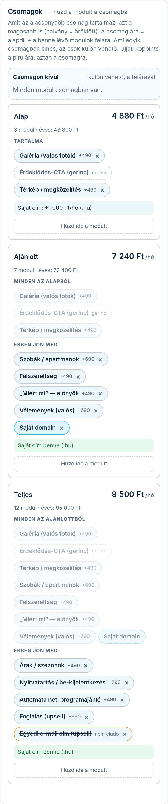
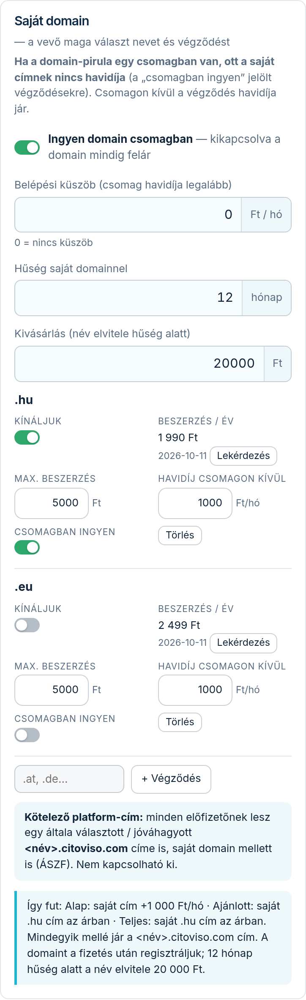

Az **„Árazás és értékesítés”** képernyőn állítod be piaconként a valós árakat, a három csomag
tartalmát, hogy a saját domain melyik csomagban jár díj nélkül, a lead-ajánlatokat, az ingyenes
próbát és a kupont. Itt van az a kapcsoló is, ami nélkül a rendszer egyáltalán nem hirdethet árat.
Ez az árazás egyetlen forrása: a konfigurátor, a megrendelés és a levelek ár-sora is innen olvas.

**Hol találod:** a bal oldali menüben a **CRM** modul alatt, **„Árazás”** néven. Mellette egy jelvény
mutatja, hány modul eladható a katalógusból (például „13/14 eladó”).

## A lap felépítése

1. **Piac-fülek** a cím alatt: „Magyarország · HUF” és „Globális · EUR”. Minden piacnak saját
   ár-sora van; amelyik piacra nincs mentett ár, az a globálisra esik vissza. A „+ Ország” fül
   halvány: az ország szerinti bontás később jön.
2. **Három összesítő kártya:** **„Csomagok”** (nagy számmal az Ajánlott csomag havidíja, alatta az
   Alap, a Teljes és az éves kedvezmény), **„Modulok”** (hány modul eladó az összesből, hány van
   csomagon kívül, hány leállítva, és hogy a saját domain csomagban jár vagy felár) és **„Ajánlatok
   és próba”** (a bemutatkozó kedvezmény, a döntés-segítő, a próba és a kupon). A kártyák mentés
   előtt is azonnal követik, amit átírsz.
3. **„Figyelmet kér”** lista: amit a beállításaidban érdemes rendbe tenni, például egy leállított
   modul, ami még egy csomagban van, vagy egy végződés, aminek nincs mért ára. A sorra koppintva a
   lap az érintett szakaszhoz ugrik. Ha nincs ilyen: „Minden rendben — nincs teendő ezen a piacon.”
4. **Szakasz-gombok:** Csomagok · Modulok · Alapdíj · Kupon · Saját domain · Lead-ajánlatok ·
   Ingyenes próba · Véglegesítés. Görgetéskor is fent maradnak. Ha egy szakaszban mentetlen
   változás van, a gombja mellett borostyán pötty jelenik meg. Telefonon a gombsor nem fér ki egy
   képernyőre: a sort oldalra húzva éred el a többi gombot (Lead-ajánlatok, Ingyenes próba,
   Véglegesítés).
5. A **mentés-sáv** mindig látható a lap alján: „● N szakaszban mentetlen változás”,
   **„Visszaállítás”** és a „Mentés — {piac}” gomb (például „Mentés — Magyarország”). A
   „Visszaállítás” újratölti a lapot az utoljára mentett állapottal. Ha van mentetlen változás, a
   böngésző előbb megkérdezi, hogy elhagyod-e a lapot: ha a változásokat el akarod dobni, válaszd a
   távozást (a gomb neve böngészőnként más, például „Távozás” vagy „Újratöltés”). Ugyanezt kérdezi
   akkor is, ha mentés nélkül másik lapra lépnél.

## Csomagok — húzással

A **„Csomagok”** panelen te döntöd el, melyik modul melyik csomagban van. A csomag ára az alapdíjból
és a benne lévő modulok felárából áll össze, külön nem írod be.

- **Húzd a modult** a pirulájánál fogva a kívánt csomag oszlopába. Ujjal is működik; ha a képernyő
  aljára vagy tetejére érsz, a lap magától görget. Húzás helyett **koppinthatsz** is: koppints a
  pirulára (kiemelődik), aztán a csomagra.
- **Amit az alacsonyabb csomag tartalmaz, azt a magasabb is.** Az öröklött modulok halványan, a
  **„Minden az Alapból”** / **„Minden az Ajánlottból”** felirat alatt látszanak, a csomag saját
  többlete az **„Ebben jön még”** alatt. Ha egy modult magasabb csomagba húzol, az alacsonyabbakból
  kikerül.
- A pirulán lévő **×** kiveszi a modult a csomagokból; ilyenkor a **„Csomagon kívül”** sávba kerül,
  és csak külön vehető, a felárával. A sávba húzva is kiveheted.
- **Függőségek:** ha egy modul egy másikra épül (például az online foglalás az árakra, az árak a
  szobákra), a rendszer nem engedi szétszakítani őket. Három eset van, és mindegyiket kiírja a
  panel alatt:
  - Ha behúzol egy ilyen modult, a függősége vele kerül ugyanabba a csomagba, akkor is, ha eddig
    csomagon kívül vagy magasabb csomagban volt („Vele ment: Árak / szezonok …”).
  - Ha egy modult magasabb csomagba húzol, a rá épülő, alacsonyabb csomagban lévő modulok is
    feljebb kerülnek („Feljebb került: …”).
  - Ha kiveszel egy modult, ami másoknak kell, a rá épülők is kikerülnek („Vele kikerült: …”).
- Az **érdeklődés-CTA** (gerinc) mindig az Alapban van, nem mozdítható.
- A **leállított** modul áthúzva, „nem eladó” jelöléssel marad a csomagban, és nem számít az árba;
  a rá épülő modulok ugyanígy jelölődnek. A „Figyelmet kér” listán is megjelenik.
- A **„Saját domain”** is egy pirula. Abban a csomagban, ahová húzod (és a felette lévőkben), a
  saját címnek nincs havidíja. Ezt csak akkor húzhatod csomagba, ha a „Saját domain” panelen az
  **„Ingyen domain csomagban”** kapcsoló be van kapcsolva.
- Oszloponként a csomag ára, a modulok száma, az éves ár és egy sor arról, mennyibe kerül ott a
  saját cím (benne / +díj/hó / nem választható).

A csomagok összetétele minden piacra közös. A mentéskor a szerver is ellenőrzi: ha egy modul
alacsonyabb csomagba került, mint amire épül, **semmit nem ment**, és a lap tetején ez áll: „Nem
mentettem: a csomagok összetétele érvénytelen …”

## Modulok — felár és eladhatóság

A **„Modulok”** tábla csoportonként (Amit bemutat · Elérhetőség · Extrák) sorolja a modulokat.
Soronként: a modul neve, hogy melyik csomagtól jár (például „Ajánlott-tól”, vagy „csak külön”), hány
élő előfizetés van rá, a felár, és az eladhatóság kapcsolója. A gerincnél „gerinc — az alapdíjban”
és „mindig” áll: se kapcsolója, se külön ára nincs. Telefonon soronként két sor: a név, alatta a
csomag, az élő darabszám, a felár és a kapcsoló.

A kapcsoló azt dönti el, hogy a modul **új ügyfélnek eladható-e**:

- **Bekapcsolva** — a modul normálisan megjelenik az ajánlatban.
- **Kikapcsolva** — a modul neve áthúzva jelenik meg, és a sor kiírja: **„Leállítva — új
  előfizetés nem köthető rá; a meglévők futnak tovább.”**

A tábla fölött a képernyő ezt ki is mondja: „A kikapcsolt modult új ügyfél nem kapja meg
(konfigurátor, kiküldött mock, konverzió) — a meglévő előfizetéseket nem érinti.”

> ⚠️ **A Többnyelvű honlap három sávja külön árazódik.** A „Többnyelvű honlap” sorban az
> **Alap** csomag ára áll, alatta pedig — saját, behúzott sorban — a **Bővített** és a
> **Teljes** sáv ára is szerkeszthető. Mindhárom **egyszeri** díj („Ft / alkalom”), nem havidíj,
> és csomagba nem tehető.

⚠️ **Mit jelent ez a gyakorlatban?** A kikapcsolás MIND A NÉGY eladási pontot lezárja: a
prospect-konfigurátorban nem választható, a kiküldött mockban mintaként sem jelenik meg,
konverziókor sem kerül bele a csomagba, és a tenant-admin sem tud rá előfizetni. Aki viszont
MÁR fizet érte, annak változatlanul megy tovább. Az „élő” jelvény (például „3 élő”) a
figyelmeztetésed: a kikapcsolás őket nem vágja el, de új ügyfelet nem szerzel rá többé.

A modul-felárak jelenleg globálisak (HUF): a táblát a **Magyarország** fülön szerkeszted.

## Alapdíj és éves fizetés

- **„Alapdíj”** — a havi előfizetés alja; a gerinc (honlap + érdeklődés-CTA) benne van.
- **„Éves előfizetés — ingyen hónapok”** — éves fizetésnél ennyi hónap ingyenes (12 − N hónap árát
  fizeti).

Az alatta lévő „Így fut:” mondat az Ajánlott csomaggal számolva mutatja a havi és az éves árat.

## Saját domain

A vevő maga választ nevet és végződést, a kínált végződések közül. A panel:

- **„Ingyen domain csomagban”** kapcsoló. Bekapcsolva a „Saját domain” pirula csomagba húzható, és
  ahol benne van, ott a saját címnek nincs havidíja (a „csomagban ingyen” jelölt végződésekre).
  Kikapcsolva a domain mindig felár; ha csomagban volt, kikerül onnan. Ez a kapcsoló piaconként
  külön van.
- **„Belépési küszöb (csomag havidíja legalább)”** — ekkora csomagtól választható saját cím
  felárért. **0 = nincs küszöb**: bármelyik csomag mellé kérhető. A küszöböt a listaár dönti el,
  kedvezmény nem számít bele. Ha a csomag a domaint tartalmazza, a küszöb nem számít. Ha a küszöb
  nagyobb 0-nál, a hűségidő alatt a csomag nem csökkenhet alá.
- **„Hűség saját domainnel”** — hány hónap előfizetést vállal, aki rajtunk keresztül kér domaint.
- **„Kivásárlás (név elvitele hűség alatt)”** — ennyit fizet, aki a hűségidő alatt kilép és a nevet
  elviszi.

**A végződés-tábla** soronként egy végződés (például .hu):

- **Kínáljuk** — csak a bekapcsolt végződésből választhat a vevő. Bekapcsolni csak mért árú, a
  plafon alatti végződést lehet.
- **Beszerzés / év (nettó)** — amennyibe a regisztrátornál egy év kerül, a mérés dátumával
  (telefonon a felirat rövidebb: „Beszerzés / év”). A **„Lekérdezés”** gomb most kérdezi le a
  regisztrátortól (ez nem rendel semmit). Ha a regisztrátor nem ad árat, a végződés nem kínálható.
- **Max. beszerzés** — ennél drágább nevet a rendszer nem vesz meg (a prémium nevek így nem
  csúszhatnak át). Ha a beszerzés a plafon fölé kerül (mert a plafont lejjebb vetted, vagy a
  „Lekérdezés” drágább árat hozott), a végződés kínálása kikapcsol, és a cella alatt ez áll: „A
  beszerzés a plafon felett — nem kínálható.” Újra kínálni a plafon emelése után tudod.
- **Havidíj csomagon kívül** — ennyi a saját cím havidíja, ahol nem csomag-tartalom. Kedvezmény
  erre a díjra soha nem megy.
- **Csomagban ingyen** — ha be van kapcsolva, és a vevő csomagja tartalmazza a domaint, ennek a
  végződésnek nincs havidíja. Ez a kapcsoló csak akkor nyomható, ha fent az „Ingyen domain
  csomagban” be van kapcsolva.

- **„+ Végződés”** — új végződést veszel fel (például .at); utána kérdezd le az árát, mielőtt
  kínálod. **„Törlés”** — kiveszi a sort.

Ha a „Max. beszerzés” vagy a „Havidíj csomagon kívül” mezőbe nem egész szám kerül, „Egész szám
kell.” üzenet jön, a mező piros keretes marad, és a mentés-gomb addig nem nyomható meg; a
mentés-sávban ez áll: „A mentés addig nem megy, amíg a végződés-tábla jelölt mezője hibás.”

A tábla alatt a **„Kötelező platform-cím:”** jegyzet: minden előfizetőnek lesz egy általa választott vagy
jóváhagyott <név>.citoviso.com címe is, saját domain mellett is (ÁSZF). Ez nem kapcsolható ki. A
panel alján az „Így fut:” mondat csomagonként mondja meg, mennyibe kerül a saját cím.

## Lead-ajánlatok — a bemutatkozó és a döntés-segítő ajánlat

A **„Lead-ajánlatok”** panel a „Saját domain” alatt, az „Ingyenes próba” mellett van (telefonon fölötte). Itt állítod be,
mekkora kedvezményt ígér a kiküldött levél, és mikor, mekkora, meddig érvényes plusz kedvezményt kap az a lead,
aki többször is megnyitja a neki küldött tervet, de még nem rendelt. Ez a beállítás **„minden piacra érvényes”**:
bármelyik régió oldalán ugyanazt látod, és bármelyik régió mentése menti.

Hogyan működik: a kiküldött levél egy bemutatkozó kedvezményt ígér, ez az első megnyitástól határidő nélkül él. Ha
a lead a tervet a megadott számú alkalommal megnyitja (alapbeállításban: a megadott számú KÜLÖNBÖZŐ NAPON, lásd lent a
2. pontot), és még nem vásárolt, a lap egy döntés-segítő ajánlatot mutat
neki: nagyobb kedvezményt az első díjból, a megadott ideig. Megnyitásnak az számít, amikor a lead a lapon görget,
koppint, kattint vagy billentyűt üt, vagy a lap 5 másodpercig látható; ezért a döntés-segítő ajánlat is ekkor, menet
közben jelenik meg, nem a lap betöltésekor (a részletek a Megkeresés-piszkozat súgójában, „Mi számít megnyitásnak?”). Ha addig sem rendel, a megadott késleltetés után
e-mailben is emlékeztetjük rá, ha van e-mail címe, nem iratkozott le, és az ajánlat még nem járt le. Az emlékeztetőt
óránként küldjük, reggel 8 és este 8 óra között: az éjjel esedékes emlékeztető reggel 8 után megy ki. Egy ajánlatra
legfeljebb egy emlékeztető megy. Egy kiküldött tervre az ajánlat egyszer jár.

**Az ajánlat neve a vevőnél.** A vevő minden felületen (a fizetési lap mindkét oldalán, a számla megjegyzésében
és a tulaj-admin nyugtáján) ugyanazt a nevet látja, és ezt az ajánlat fajtája adja: a levél ajánlata
„Bemutatkozó ajánlat a levélből”, az eszkaláció „Döntés-segítő ajánlat”, a kézzel adott kampány
„Egyedi ajánlat”, a megrendelés utáni kupon „Üdvözlő kedvezmény”.

**Bemutatkozó ajánlat**

1. **„Bemutatkozó kedvezmény (a levéllel jár)”**: egész százalék 5 és 50 között. Ezt a százalékot írja bele a
   levél az ajánlatba. Kisebbnek kell lennie a döntés-segítő kedvezménynél. A mező alatt a Magyarország oldalon egy
   példa mutatja, mennyi lesz a középső csomag első havi díja.
2. A levél %-a köt: a kiküldéskor a rendszer rögzíti, hány százalékot ígért a levél. Ha később átállítod, a már
   kiküldött levelek leadjei a levelükben ígért kedvezményt kapják, akkor is, ha még meg sem nyitották. Az új érték
   csak az ezután kiküldött levelekre vonatkozik. Ha ugyanannak a leadnek később újabb levél megy, az is az első
   levél százalékát idézi.

**Döntés-segítő (eszkalációs) ajánlat**

1. A **„Döntés-segítő (eszkalációs) ajánlat”** kapcsolóval kapcsolod be vagy ki. Kikapcsolva egyetlen leadnek sem
   születik új ajánlat, a négy mező és a napok-jelölőnégyzet tiltott, a legutóbb mentett számok megmaradnak, visszakapcsoláskor nem kell újra
   beírnod őket. A bemutatkozó kedvezményt a kapcsoló nem érinti.
2. **„Hányadik megnyitásnál kapja”**: egész szám 2 és 10 között. Az első megnyitás maga a levél linkje, ott még a
   bemutatkozó kedvezmény a helyén, ezért legalább 2.
   Alatta a **„Csak a különböző napokon történt megnyitások számítanak”** jelölőnégyzet, alapból bepipálva. Így a
   lead NAPJAI számítanak: ha egy napon telefonon és gépen is megnyitja a tervet, az egy megnyitásnak számít, és a
   döntés-segítő ajánlat legkorábban a beállított számú különböző napon jön (3-as értéknél a harmadik napon).
   A pipát kivéve minden megnyitás számít, egy napon belül is; ekkor egy gyors egymás utáni nézegetés percek alatt
   kiválthatja az ajánlatot. Bekapcsolt döntés-segítőnél a mező alatti sor és az előnézet („… (különböző napon
   történt) megnyitáskor”) kimondja, melyik szabály él. A napot magyar idő szerint számoljuk.
3. **„Kedvezmény az első díjból”**: egész százalék, nagyobb a bemutatkozó kedvezménynél, legfeljebb 90. A
   kedvezmények nem adódnak össze, mindig a legnagyobb érvényes: ha a bemutatkozóval egyenlő vagy kisebb lenne, a
   lead soha nem kapná meg.
4. **„Az ajánlat érvényessége”**: egész óra 24 és 168 (7 nap) között. Alatta napban is látod (pl. „= 3 nap”).
5. **„Emlékeztető levél a kiadás után”**: egész óra, legalább 1, és kevesebb az érvényességnél. Alatta ez áll:
   „Utána legfeljebb még … óra marad a döntésre.” Az emlékeztetőt óránként küldjük, 8 és 20 óra között, ezért a
   levél legfeljebb egy órával a beállított idő után megy ki, éjjel pedig reggel 8-ig vár. Ha az emlékeztető után
   legfeljebb 12 óra marad a lejáratig, a mező alatt az is megjelenik, hogy egy éjszakára eső lead nem kapja meg.

**Hibák és mentés**

- A mezők alatti keretes mondat előre megmutatja, mit fog tenni a beállításod, a Magyarország oldalon egy valós
  csomagár-példával.
- Ha egy mező üres, nem egész szám, vagy a tartományon kívül esik, a hibás mező pirosan keretezett, alatta ott az
  ok. Két mező egymáshoz képest is lehet hibás: ha a döntés-segítő kedvezmény nem nagyobb a bemutatkozónál, vagy
  az emlékeztető nem korábbi a lejáratnál, mindkét mező piros lesz, bármelyiket javíthatod. Kikapcsolt
  döntés-segítőnél a bemutatkozó kedvezményt a tárolt döntés-segítő kedvezményhez méri. Ilyenkor csak a bemutatkozó
  mező lesz piros: vagy csökkented, vagy visszakapcsolod a döntés-segítőt, és ott emeled a kedvezményt.
- Hiba esetén a „Mentés — {piac}” gomb (például „Mentés — Magyarország”) nem nyomható meg. A gomb a lap alján, a mindig látható mentés-sávban van, alatta ez áll: „A mentés
  addig nem megy, amíg a jelölt mező hibás.” Ha több mező hibás, a szám is ott áll, pl. „A mentés addig nem megy,
  amíg a 2 jelölt mező hibás.” A javítandó mezőt a piros keret mutatja fent, a „Lead-ajánlatok” szekcióban.
  A lap tetején a szakasz-gombok közül a **„Lead-ajánlatok”** visz oda.

**Mi történik a már futó ajánlatokkal?**

- A már kiadott döntés-segítő ajánlat megtartja a saját kedvezményét és lejáratát. Ha a kapcsolót, a
  megnyitás-számot, a „Csak a különböző napokon …” jelölőnégyzetet, a kedvezményt vagy az érvényességet átállítod, miközben ilyen ajánlatok futnak, a mezők alatt
  megjelenik, hány darab fut és hány százalékkal.
- Ha a bemutatkozó kedvezményt állítod át, ott az jelenik meg, hogy a már kiküldött levelek a bennük ígért
  kedvezményt tartják.
- Az emlékeztető késleltetése viszont a már futó ajánlatokra is hat: minden óránkénti küldés a kiadás óta eltelt
  időből számol. Ha az ajánlat addigra lejár, nem megy ki emlékeztető. A felület ezt is kiírja, ha a késleltetést
  átállítod.

## Ingyenes próba — hossz

Az **„Ingyenes próba”** panel a „Lead-ajánlatok” mellett van. A kiküldött tervet megnyitó lead kártya nélkül
kipróbálhatja a saját oldalát: a beállított csomag moduljai aktívak, az oldal a citoviso.com aldomainjén (a
platform-címén) él, a próbáért nem fizet, és számla sem készül. Ez a beállítás is **„minden
piacra érvényes”**: bármelyik régió oldalán ugyanazt látod, és bármelyik régió mentése menti.

1. Az **„Ingyenes próba indítható”** kapcsolóval kapcsolod be vagy ki. Kikapcsolva új próba nem indítható (aki
   mégis elküldi a próba-kérést, elutasítást kap), a mező tiltott, a legutóbb mentett szám megmarad,
   visszakapcsoláskor nem kell újra beírnod. A már futó próbák a saját határidejükig futnak.
2. **„A próba hossza”**: egész nap 1 és 90 között. Alapból 14 nap.
3. **„A próbázó ezt kapja”**: melyik csomag moduljait használhatja a próba alatt (Teljes, Ajánlott vagy Alap
   csomag). A csomagok tartalmát a lap tetején, a „Csomagok” panelen állítod. Amíg ezt egyszer el nem mented, a
   próba a régi szabály szerint minden modult megkap. Amit itt beállítasz, azt ígéri a próba-űrlap, a
   belépő-levél és a próbázó Modulok füle is: a csomag nevét és a benne lévő modulokat (a „minden funkció”
   szöveg csak akkor marad, ha a csomag minden modult tartalmaz).

A próbázó kuponját itt nem állítod: ugyanazt kapja, mint a közvetlen vevő, a lenti **„Kupon”** szekció szerint.

A mezők alatti keretes mondat előre megmutatja, mit kap az, aki ezután próbát indít. Alatta az áll, hány próba fut
most („Most 2 próba fut.” vagy „Most nem fut próba.”).

**Mi történik a már futó próbákkal?** Semmi: a próba hossza az indulásakor rögzül. A változás csak az ezután
indított próbákra hat. A képernyő ezt ki is írja a futó próbák száma mellett.

**Hibák és mentés.** Ha egy mező üres, nem egész szám, vagy a tartományon kívül esik, a mező pirosan keretezett,
alatta ott az ok, és a mentés-gomb nem nyomható meg. A gomb mellett ez áll: „A mentés addig nem megy,
amíg az „Ingyenes próba” jelölt mezője hibás.” Ha a szerver mégis hibás értéket kap, **semmit nem ment**, az árakat
sem, és a lap tetején ez jelenik meg: „Nem mentettem: az Ingyenes próba egyik mezője a megengedett tartományon kívül
esik.” Egy régi, nyitva hagyott fül, amin még nem volt ilyen szekció, mentéskor nem írja át a próba beállítását.

A szekció címe melletti **?** ikon a próba teljes útját nyitja meg: hol látod a próbát a riportban és a lead lapján,
mi történik a vége előtt és után, hogyan folytatja a próbázó, mikor törlődnek az adatai, és mit jelentenek a
próba-riasztások.

## Kupon — egy kupon mindenkinek

A **„Kupon”** panel az „Alapdíj és éves fizetés” mellett van (telefonon alatta). Aki admin-hozzáférést kap, egy kupont kap: a közvetlen vevő
az első fizetésekor, a próbázó a próba indulásakor. Fiókonként egy kupon van, és egyszer használható, bármire:
a próbázónál a próba folytatására vagy egy modulra, amelyik előbb jön. Második kupon nem jár: aki próbával kapta,
a folytatás fizetésekor már nem kap újat. Ez a beállítás is **„minden piacra érvényes”**.

1. **„Kedvezmény”**: egész százalék 0 és 90 között. Alapból 25%. A **0** azt jelenti, hogy senki nem kap kupont;
   a próba ettől még fut. A kupon a vevőnél „Üdvözlő kedvezmény” néven jelenik meg, és a kedvezmények nem adódnak
   össze, mindig a legnagyobb érvényes.
2. **„Érvényesség”**: egész nap 1 és 365 között. Alapból 90 nap. A közvetlen vevőnél a fizetés napjától számít,
   a próbázónál a próba utolsó napjától.

A mezők alatti keretes mondat előre megmutatja, mit kap, aki ezután admin-hozzáférést kap. Alatta az áll, hány fel
nem használt kupon van most kint. A már kiadott kupon megtartja a saját kedvezményét és lejáratát: a változás csak
az ezután kiadott kuponokra hat.

**Hibák és mentés.** Ugyanúgy, mint a fenti szekcióknál: hibás mezőnél a mentés-gomb nem nyomható meg,
mellette ez áll: „A mentés addig nem megy, amíg a „Kupon” jelölt mezője hibás.” Ha a szerver mégis hibás értéket
kap, semmit nem ment, és a lap tetején ez jelenik meg: „Nem mentettem: a Kupon egyik mezője a megengedett
tartományon kívül esik.”

## Az ár-hirdetési kapu (fogyasztóvédelmi kapu)

A **„Véglegesítés”** panelen egy jelölőnégyzet: **„Az árak véglegesek, élesíthetők”**. Amíg NINCS
bepipálva, a kiküldött levél nem hirdethet árat, és a nyilvános oldal „Egyedi ajánlat”-ot mutat. Ez
fogyasztóvédelmi kapu (megtévesztő ár-állítás tilalma) — csak akkor pipáld be, ha az árak tényleg
véglegesek. A lap tetején a jel ezt mutatja: „Véglegesítve — a levelek árat hirdethetnek” vagy
„Nincs véglegesítve — a levél nem hirdet árat”.

## Mentés

A „Mentés — {piac}” gomb (például „Mentés — Magyarország”) a kiválasztott piac árait, a
végződés-táblát, az eladhatóság-kapcsolókat és a csomagok összetételét menti. A mentés azonnal él:
a következő konfigurátor-megnyitás és mock-kiküldés már az új árakkal számol. Piaconként külön
ments — a magyar mentés a globálist nem írja át. Kivétel a **„Csomagok”**, a **„Lead-ajánlatok”**,
az **„Ingyenes próba”** és a **„Kupon”**: ezek minden piacra közösek, ezért bármelyik piac mentése
menti őket. Ha a végződés-tábla hibás (mért ár nélkül vagy a plafon felett kínált végződés), a
szerver semmit nem ment, és ezt írja: „Nem mentettem: a végződés-tábla hibás …”
