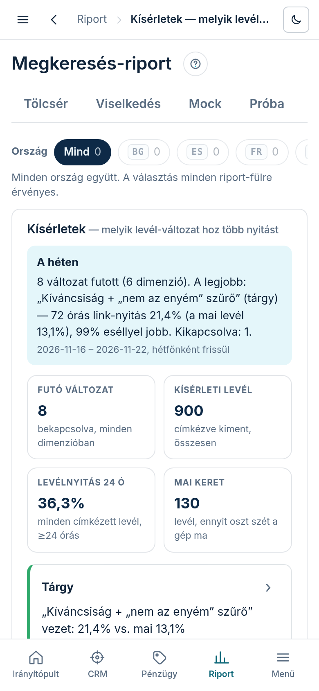

A Kísérletek fül a hideg megkereső levél változatait mutatja: melyik tárgy, első sor, feladó,
levél-forma, kép és ár-sor hoz több nyitást, és ma hogyan osztja szét a gép a napi keretet. Itt nem
kell semmit beállítani — a gép magától osztja a levelet a jobb változatok felé, a fül azt mutatja,
mit lát.

## Hol találod

Számítógépen a bal menüben **„Riport”** → **„Kísérletek — melyik levél-változat nyer”**, vagy a
Riport bármelyik lapján a fülsor **„Kísérletek”** füle (a sor végén, a „Lead-állomány” után).

Telefonon az alsó sávban koppints a **„Riport”** gombra, majd a lap tetején lévő fülsort húzd
balra, amíg a **„Kísérletek”** fül előjön — a fülsor oldalra görgethető, a végén van.

**„Ország” sáv:** a fülsor alatt — mint minden riport-fülön — a lead országa szerint számolja a kísérleti leveleket, és minden változat-szám arra az országra szűkül. A választás mind a 8 riport-fülön megmarad, amíg vissza nem állítod „Mind”-re (részletek: a Riport tölcsér-lapjának súgójában).

## Mit mutat

- **„A héten”** sor legfelül: az előző lezárt hét (hétfőtől vasárnapig) összegzése, hétfőnként
  frissül. Megmondja, hány változat futott, melyik a legjobb a mai levélhez képest, és mekkora
  eséllyel jobb tényleg — és hogy hány változatot kapcsolt ki az őr.
- **Négy szám**: **„Futó változat”** (bekapcsolt változat, minden dimenzióban), **„Kísérleti
  levél”** (ennyi címkézett levél ment ki eddig), **„Levélnyitás 24 ó”** (a levelek hány százalékát
  nyitották meg egy napon belül), **„Mai keret”** (ennyi levelet oszt szét ma a gép).
- **Dimenziónként egy sor** (**„Tárgy”**, **„Első sor”**, **„Feladó”**, **„Törzs”**, **„Kép”**,
  **„Ár-sor”**), mindegyikben egy ítélet. Ha csak a mai levél fut, nincs mit összevetni. Az Első
  sor csak a dobozos levélen van (a személyes levél a megszólítással kezdődik), az ár-mondat csak a
  személyes levélben — a sor jobb oldalán ezt is kiírja.
- Ha egy új változat **vezet**, zöld csík jelzi, és a sor kiírja a két számot. Vezet = azok közül,
  amelyeknek már legalább 30 „érett” (72 óránál régebbi) levele van, ennek a legmagasabb a 72 órás
  link-nyitása. Ez még nem bizonyosság, csak a mostani állás; az esélyt a heti sor mondja meg.
- Különben „A mai levél tartja magát”. Ez akkor is így van, ha a táblában egy új változatnál
  magasabb százalékot látsz, de még nincs 30 érett levele — kevés levélből a szám még csalóka.
- Egy sorra koppintva kinyílik a tábla: **„Változat”**, **„Állapot”**, **„Ma”** (a mai osztás),
  **„Küldés”**, **„Levélnyitás 24 ó”**, **„Link 24 ó”**, **„Link 72 ó”**, **„Válasz”**,
  **„Leiratkozás”**. Telefonon minden változat egy külön kártya: fent a neve, alatta az állapota, majd a számok egymás
  alatt, mindegyik előtt a neve.
- Állapot: **„kontroll · fut”** (a mai levél, ehhez mérünk), **„fut”**, **„kikapcsolta az őr”**
  (alatta az ok), **„jóváhagyásra vár”** (a szövegét még nem hagyta jóvá a tulaj).

## Honnan jönnek a számok?

- **Levélnyitás**: a levélben lévő kép a mi szerverünkről töltődik be; ha a levelezőprogram
  letölti, a levelet megnyitották (a Gmail képproxyja is ide számít). Az Apple Mail minden képet
  előre letölt, akkor is, ha senki nem nyitja meg — ezért ezt NEM számoljuk nyitásnak, és ezen a
  fülön nem is jelenik meg külön számként. Az Apple Mailt használók valódi nyitása így kimarad: a
  levélnyitás inkább alacsonyabb a valóságnál, mint magasabb.
- **Link-nyitás**: a levél linkjére kattintott, gépek nélkül. A gép a **72 órás** link-nyitás
  szerint osztja a keretet; minden futó változat legalább 10%-ot kap, hogy a gyengébbnek látszó se
  haljon ki túl korán.
- **Az őr naponta egyszer néz** (a nap első keret-osztásakor), ezért egy napközben jött jel után a
  változat aznap még futhat, és a következő napi osztásnál kapcsol ki.
- **Őr, első szabály**: egy új változatot már az első panaszos válasz után (például „spam”,
  „zaklatás”) kikapcsol a következő napi osztásnál, levélszámtól függetlenül.
- **Őr, második szabály**: ha a változat már 100 levelet kiküldött, és a leiratkozása több, mint a
  mai levélé + 0,5 százalékpont, kikapcsolja. Példa: ha a mai levélnél 100-ból 1,2 iratkozik le
  (1,2%), az új változat 1,7% fölött esik ki. Ez a szabály csak akkor dönt, ha a mai levélnek is van
  már 100 levele, különben nincs mihez mérni.
- A mai levelet az őr soha nem kapcsolja ki. Riasztó levelet küld, ha arra panaszos válasz jön,
  vagy ha a leiratkozása 2% fölé megy.
- A százalékok csak a már elég régi leveleket számolják (24, illetve 72 óránál régebbi), mert egy
  ma kiment levélnek még nem volt ideje hatni.
