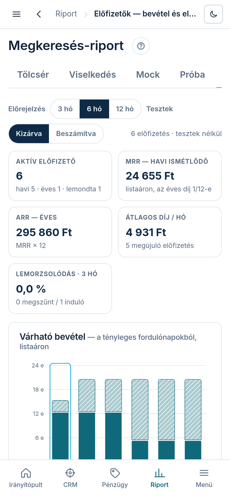
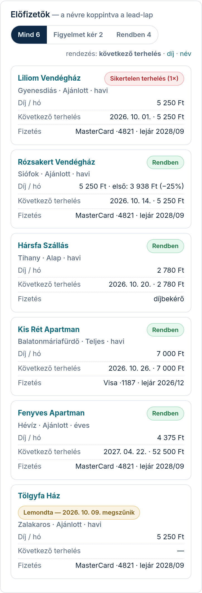

Az Előfizetők fül arra felel, kik fizetnek elő, mennyi pénz jön be havonta, és mennyi jön a
következő hónapokban: a tényleges fordulónapokból, azon az összegen, amit a rendszer
megújításkor ténylegesen terhelni fog.

## Hol találod

A bal menüben **„Riport”** → **„Előfizetők”**, vagy a Riport bármelyik lapján a fülsor
**„Előfizetők”** füle.

## Mit mutat

A szűrősor: az **„Előrejelzés”** hossza (3, 6 vagy 12 hónap, az aktuális hónappal kezdve) és a **„Tesztek”** (**„Kizárva”** · **„Beszámítva”**). Teszt az a szállás, amelynek
neve „[TESZT]”-tel kezdődik; alapból nem számít bele semmibe.

- **Öt szám**: **„Aktív előfizető”** (alatta havi / éves, befagyott, lemondta);
  **„MRR — havi ismétlődő”** = a megújuló előfizetések következő díja havira vetítve (az éves díj
  tizenkettede); **„ARR — éves”** = MRR × 12; **„Átlagos díj / hó”**; **„Lemorzsolódás · 3 hó”** =
  az elmúlt 3 hónapban megszűnt előfizetések aránya a 3 hónappal ezelőtti létszámhoz. Ha 3 hónapja
  még nem volt előfizető, ott **„nincs adat”** áll.
- **„Várható bevétel”**: hónaponként egy oszlop. A sötét rész **biztos** (tárolt kártya, ami a
  terhelés napján még érvényes, és nem mondták le), a csíkos rész **becsült** (díjbekérővel fizet,
  lejár a kártyája a terhelés előtt, nincs adatunk a kártyáról, vagy már van tartozása). Alatta a
  havi tábla, benne a **„Domain-kiadás”**: a saját domain évenkénti megújítása a regisztrátornál,
  ez nálunk KIADÁS. **Egy hónapra koppintva** (az oszlopon vagy a táblában) alatta megjelenik,
  ki mennyit és mikor fizet abban a hónapban, és miért biztos vagy becsült. A lemondott előfizetés
  a periódusa végén **„megszűnik”** jelzést kap, onnan nem számol.
- A **futó próbák** nincsenek benne az előrejelzésben: hogy hányan rendelnek meg egy próbát, arra még
  nincs mért adat, ezért a lap csak felsorolja őket.
- **„Tény-bevétel”**: a beérkezett fizetések havonta, a kiállított számlák, a sikertelen terhelések
  (kártyás megújítás vagy kézi újrapróbálás), a számla-hibák, és alatta a mai **kintlévőség**.
- **„Előfizetők mozgása”**: havonta hány új előfizető jött, hányan mondták le (a periódus végéig még
  fut), hányan fagytak be, hány előfizetés szűnt meg, és hány volt aktív a hónap végén.
- **„Kedvezmény és csomagok”**: mennyi kedvezményt adtunk az első fizetésekben, és hogy megújuláskor
  mindenki listaáron fizet; csomagok és modulok szerinti bontás havi összegben.

- **„Előfizetők”** tábla: szállásonként egy sor — csomag és modulszám, havi díj (alatta az első,
  kedvezményes fizetés), havi vagy éves, kártyás vagy díjbekérős, a következő terhelés napja és
  összege, a kártya és a lejárata, és az állapot: **„Rendben”**, **„Kártya lejár a terhelés előtt”**,
  **„Nincs kártya-adat”**, lemondta (a megszűnés napjával), sikertelen terhelés (a próbálkozások
  számával), **„Befagyott — nem fizetett”**. A tábla fölött szűrhetsz (mind / figyelmet kér / rendben), és
  rendezhetsz a következő terhelés, a díj vagy a név szerint. A névre koppintva megnyílik a
  lead-lap. Telefonon a tábla kártyákká alakul.

## Honnan jönnek a számok?

- A **következő díj** ugyanaz, amit a rendszer a megújításkor terhel: ha a megújítási rendelés
  már elkészült, annak az összege; ha még nem, a ténylegesen számlázott modulok listaára + az
  alapdíj + a saját domain díja, ha jár. A próba alatt ajándékba kapott modul nem számít.
- A **kedvezmény** csak az első fizetésre szól; megújuláskor a listaár megy.
- A **kártya lejárata** a tárolt kártya adataiból jön; a lejárat hónapjának végéig érvényes.
- A **domain megújítási ideje** a regisztrátortól mért lejárat; a költség a mért beszerzési ár
  (nettó).
- A hónapok és a napok magyar idő szerint számolnak.
