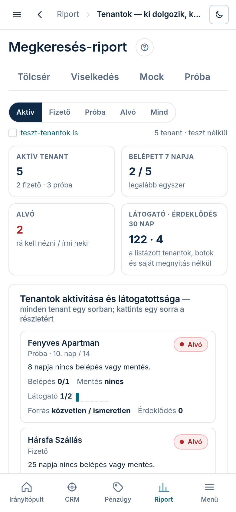

A Tenantok fül minden élő vagy próbás oldalt egy táblában mutat: belép-e a tulaj, ment-e valamit,
hányan nézik az oldalát, honnan jönnek, és ki „alszik” — akire rá kell nézni, vagy írni neki.

## Hol találod

A bal menüben **„Riport”** → **„Tenantok — ki dolgozik, kit néznek”**, vagy a Riport bármelyik
lapján a fülsor **„Tenantok”** füle.

## Mit mutat

- **Szűrők**: **„Aktív”** (fizető + próba), **„Fizető”**, **„Próba”**, **„Alvó”**, **„Mind”**, és
  a **„teszt-tenantok is”** jelölő — alapból a tesztek kimaradnak.
- **Négy szám**: **„Aktív tenant”** (fizető és próba), **„Belépett 7 napja”** (legalább egyszer),
  **„Alvó”** (rá kell nézni / írni neki), **„Látogató · érdeklődés 30 nap”** (a listázott
  tenantok összesen, botok és saját megnyitás nélkül).
- **„Tenantok aktivitása és látogatottsága”** tábla (telefonon kártyák): **„Tenant”**,
  **„Belépés 7/30”**, **„Utolsó mentés”**, **„Látogató 7/30”** (mellette a 30 napos kis
  diagram), **„Fő forrás”**, **„Érdeklődés 30 nap”**, **„Jelzés”**. A fejlécre koppintva
  rendez; egy sorra koppintva kinyílik, miért kapta a jelzést, mi volt az utolsó esemény, és egy
  link a partner-lap aktivitás-blokkjához.
- **Jelzés**: **„Aktív”**, **„Új”**, **„Még nem lépett be”** (3 napnál fiatalabb), **„Alvó”**
  (fizetőnél 14 napja, próbánál 5 napja nincs belépés vagy mentés, vagy 3 nap után sem lépett
  be), **„Lezárult”**, **„Teszt”**.

## Honnan jönnek a számok?

Látogató = egy böngésző egy napon egyszer számít (IP nélkül tárolva), botok nélkül; ha a böngésző
aznap a tenant-adminból vagy a konzolból jött, az a tulajé vagy a miénk, nem számít bele. Csak a
főoldal megnyitását mérjük; ország, aloldal és telefon- vagy e-mail-kattintás nincs mérve. A
forrás a küldő oldalból jön (Google, közösségi, szállásportál, e-mail, közvetlen…).
