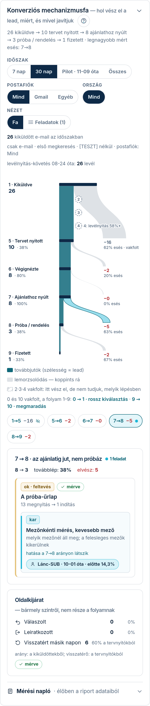

A Konverziós mechanizmusfa a megkeresés útját mutatja a kiküldött e-mailtől a fizetésig egyetlen
folyamként: hány lead jut tovább lépésről lépésre, hol morzsolódik le a legtöbb, mi lehet ennek az
oka, és melyik javításon (karon) ki dolgozik éppen. A fa a közös modell (állapot → ok → mérés → kar):
minden konverziós ötlet egy csomópontjához kötődik.

## Hol találod

A bal menüben **„Riport”** → **„Megkeresés-tölcsér”**, a **„Tölcsér”** fül legtetején, a kérdés-kártyák
felett. Telefonon az alsó sávban koppints a **„Riport”** gombra, majd a megnyíló lap „Funkciók”
listájában a **„Megkeresés-tölcsér — hol akadnak el”** sorra — a fa a Tölcsér lap első doboza.

A doboz fejlécére koppintva összecsukható. Csukva egyetlen sor marad: a kiküldöttek, a tervnyitók, az
ajánlathoz nyúlók, a próbák és a fizetők száma, és hogy hol a legnagyobb mért esés.

## A szűrők

- **„Időszak”**: **„7 nap”**, **„30 nap”**, „Pilot · 11-09 óta” (az e-mailes első kör kezdete óta)
  vagy **„Összes”**. Ugyanaz az időszak, mint a lap többi részén: ha a lap tetején mást választasz
  (például **„Ma”** vagy egyedi dátumot), a fa is arra számol, és kiírja.
- **„Postafiók”**: **„Mind”**, **„Gmail”** vagy **„Egyéb”** — a címzett levelezője szerint. A
  Gmail a levélnyitást pontosan jelzi, a többi levelező alulszámol.
- **„Ország”**: a lead országa — **„Mind”**, mellette legfeljebb három ország kétbetűs kódja (pl.
  „HU”), a legtöbb kiküldéssel; a többi ország a lap tetején lévő ország-sávon választható. Ha egy országba még nem ment levél, a fa ezt kimondja („Ebben a
  szűrésben nem ment ki levél”), és nem mutat nullákat. Két gombbal jutsz ki belőle:
  **„Ország és postafiók: Mind”** vagy **„Időszak: Összes”**.

Minden szám ugyanabból az adatból jön, mint a lap többi panelje, ezért két panel sosem mondhat mást.
Csak az e-mailes első megkeresés számít, saját teszt-leadek nélkül.

## A folyam

Asztali gépen balról jobbra, telefonon fentről lefelé fut: **1 · Kiküldve** → **5 · Tervet nyitott**
→ **6 · Végignézte** (legalább félig legörgette a tervet) → **7 · Ajánlathoz nyúlt** (megnyitotta a
próbát, egy csomagot, az árakat vagy a rendelést) → **8 · Próba / rendelés** → **9 · Fizetett**. A sáv
szélessége a továbbjutó leadek számával arányos; a leváló szürke ág a lemorzsolódás, rajta a
veszteség és az esés százaléka.

- **Az 1 → 5 egy közös ág**, rajta a 2 · 3 · 4 jelölővel: itt vész el a legtöbb lead, de nem tudjuk,
  melyik lépésben (megérkezett-e a levél, észrevette-e, megnyitotta-e). Ezért csíkozott.
- A **4 · levélnyitás** csak részben mért: a követett levelekből számoljuk, és a Gmailen kívül
  alulszámol. Ezért a 4 → 5 arányt nem számoljuk ki, csak az 1 → 5-öt.
- A **vakfolt** (0 · Kiválasztott, 2 · Megérkezett, 3 · Észrevette, 10 · Megmaradt) csíkozott „lyuk”,
  soha nem nulla: azt jelenti, hogy nem tudjuk. A 0 → 1 és a 9 → 10 doboza a jelmagyarázat két
  linkjéről nyílik: **„0 → 1 · rossz kiválasztás”** és **„9 → 10 · megmaradás”**.

## Egy átmenet okai

Betöltéskor a **legnagyobb mért esés** ága már ki van jelölve, és a doboza nyitva van — ezért áll ott
egy átmenet-doboz koppintás nélkül is. Másikat úgy nyitsz, hogy egy leváló ágra vagy alatta az
esés-gombra koppintasz (pl. „6→7 −192”). Fent a számok (honnan hová, **„továbblép:”**, **„elvész:”**),
alatta az okok:

- **„ok · igazolt”** — válasz vagy mérés a forrás; **„ok · feltevés”** — még nem igazolt.
- A mérés-jel: **„mérve”**, **„részben”** (közvetett vagy alulszámol), **„vakfolt”**.
- Az ok alatt a **„kar”** — mivel javítható, és hogy a hatása melyik arányon látszik. Ha egy karon
  dolgozik valaki, a kar alatt ott a neve, mióta, és a szülő-arány előtte.

Az **1 → 5** doboza másképp épül fel: „1→5 összesítve: … nyitotta meg a tervet” sorral indul (a
lépésenkénti esést nem ismerjük), alatta a levélnyitás részleges száma, majd négy alblokk:
1 → 2 · 2 → 3 · 3 → 4 · 4 → 5, mindegyik a saját okaival és karjaival.

Alatta az **„Oldalkijárat”**: **„Válaszolt”**, **„Leiratkozott”** és **„Visszatért másik napon”** —
bármelyik szintről, nem része a folyamnak.

## Feladatok nézet

A szűrők mellett a „Nézet” csoportban két gomb áll: **„Fa”** és „Feladatok (n)” (n = a futó feladatok
száma). Asztali gépen a sor jobb szélén, telefonon a szűrők alatt. A Feladatok nézet a fa helyett az
aktív feladatok listáját mutatja (asztalon tábla, telefonon kártyák): csomópont, ok, kar, ki, mióta, a
szülő-arány előtte és utána. Az **„a fában”** link (telefonon **„megnyitom a fában”**) visszavisz a
fába, a csomópont dobozához; a **„Fa”** gomb is visszavált.

Az „utána” szám csak akkor jelenik meg, ha a kar indulása után kiküldött levelek már legalább egy
hetesek, és elég lead jutott el a szülő-állapotig — addig **„fut, még nincs”**. Így a fa mostani
aránya nem tűnhet a kar hatásának. Ha a kar vakfolt átmeneten dolgozik (pl. 1 → 2), az „utána” helyén
**„vakfolt — előbb mérni kell”** áll: ott előbb mérést kell építeni, addig nincs mihez hasonlítani. A feladatokat a koordinátor veszi fel; a lista szállítás nélkül
frissül.

## Mérési napló

A doboz alján nyitható. Bal oldalt a szűrt időszak számai egy összegzésben. Mellette a heti trend: a
tervnyitás a kiküldéshez képest, küldési hetenként, az utolsó hat hétre (a még futó hét halványan,
„folyamatban”). A trend a postafiók- és az országszűrőt követi, **az időszakot nem** — időszak-váltásra
nem változik, ez szándékos. Élőben számolódik, nem kézi bejegyzés.
