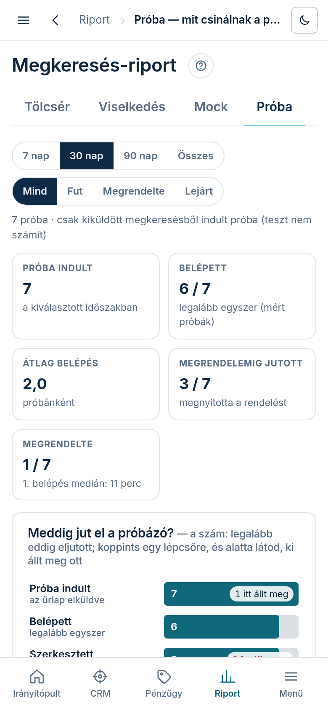
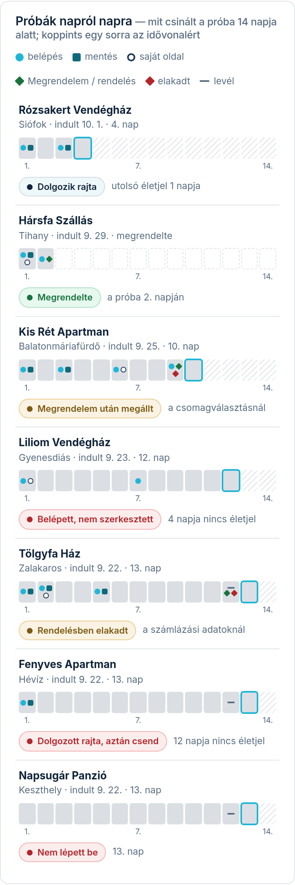

A Próba fül arra felel, hol bukik el, vagy hol sikerül egy rendelés a 14 napos ingyenes próba
alatt: hányszor lépnek be, mentenek-e valamit, megnézik-e a saját oldalukat, megnyomják-e a
**„Megrendelem”** gombot, és ha elkezdik a rendelést, hol állnak meg.

## Hol találod

A bal menüben **„Riport”** → **„Próba”**, vagy a Riport bármelyik lapján a fülsor **„Próba”** füle.

## Mit mutat

A szűrősor: az **időszak** (7 · 30 · 90 nap · **„Összes”**, a próba indulása szerint) és az
**állapot** (**„Mind”** · **„Fut”** · **„Megrendelte”** · **„Lejárt”**). Csak a kiküldött
megkeresésből indult próba számít, a teszt nem.

- **Öt szám**: hány próba indult; hányan léptek be legalább egyszer; átlagosan hányszor léptek be
  próbánként; hányan nyitották meg a rendelést; hányan rendeltek meg (alatta az első belépésig
  eltelt idő mediánja).
- **„Meddig jut el a próbázó?”**: hét lépcső — **„Próba indult”** → **„Belépett”** →
  **„Szerkesztett”** → **„Megnézte az oldalát”** → **„Megrendelem”** → **„Rendelés elküldve”** →
  **„Fizetett”**. A sávon a szám azt mondja, hányan jutottak LEGALÁBB eddig; a jobb szélén „N itt
  állt meg”, a legtöbb megállással járó lépcsőn pirossal. **Egy lépcsőre koppintva** a lenti lista
  csak azokat mutatja, akik ott álltak meg; újra koppintva, vagy a lista címe melletti
  „Itt álltak meg: … ×” címkével a szűrés megszűnik.
- **„Mennyi idő alatt”** tábla: indulás → 1. belépés, → 1. mentés, → Megrendelem, és Megrendelem →
  fizetés — medián és a leglassabb.

- **„Próbák napról napra”**: próbánként egy sor. A 14 napos sávon a jelek: kör = belépés,
  négyzet = mentés, üres kör = megnézte a saját oldalát, zöld rombusz = Megrendelem / rendelés,
  piros rombusz = elakadt, vonal = lejárat előtti levél. A mai nap keretes, a még hátralévő napok
  csíkosak. Jobbra egy mondat: **„Dolgozik rajta”**, **„Nem lépett be”**, **„Belépett, nem
  szerkesztett”**, **„Dolgozott rajta, aztán csend”** (3 napja nincs belépés vagy mentés),
  **„Megrendelem után megállt”**, **„Rendelésben elakadt”**, **„Megrendelte”**, **„Lejárt, nem
  rendelt”**. **Egy sorra koppintva** kinyílik a próba idővonala percre pontosan (a hosszabb
  csendeket is kiírja), alatta a **„Lead-lap”** gomb.
- **„A próba melyik napján dolgoznak?”**: naponként hány próbázó lépett be vagy mentett.
- **„Mock: ugyanaz tér vissza, vagy továbbküldték?”**: a kiküldött linkek látogatói — egyszer
  nyitotta meg · visszatért ugyanarról az eszközről · más eszközről is megnyitották — és
  mindegyiknél, hányan indítottak próbát.

## Honnan jönnek a számok?

- **Belépés** = az admin megnyitása, fél óránként legfeljebb egy (egy újratöltés nem új
  belépés); ha jelszóval vagy egyszeri linkkel lépett be, az idővonal azt is kiírja.
- **Mentés** = sikeres mentés az adminban, azzal a füllel, ahol mentett.
- **Saját oldal** = az admin **„Oldal”** gombjával vagy a webcímre kattintva megnyitotta az élő
  oldalát.
- **Megrendelem** = megnyitotta a rendelést, és emberi jelet adott rajta (görgetés, érintés vagy
  5 másodperc látható fül) — a levél-szkennerek megnyitása nem számít. Az idővonal azt is
  kiírja, honnan jött: az adminból vagy a próba levelétől. Az SMS-ben küldött linknél a forrás
  nem látszik.
- **Elakadt** = megnyitotta a rendelést, de egy órán belül nem küldte el; a mondat az utolsó
  lépést nevezi meg (csomagválasztás vagy számlázási adatok).
- **Elküldve, fizetve, lejárt, levél** — a rendelés, a fizetés és a próba saját adataiból.
- A mérés bekapcsolása előtt indult próbánál a belső lépések nem látszanak: a sor ezt ki is írja
  („A belseje nem mért”), és a lépcső nélkülük számol.
- A mock-oldali bontás nem tesz sütit és nem tárol semmit a látogató böngészőjében: a látogatás
  eszköz-típusa, rendszere és böngészője dönt. Két egyforma telefon egynek látszik, ezért a
  „más eszközről is” inkább kevesebb a valósnál.
