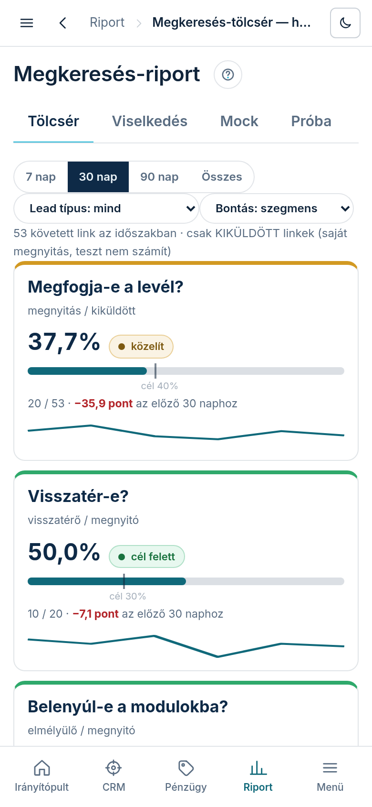
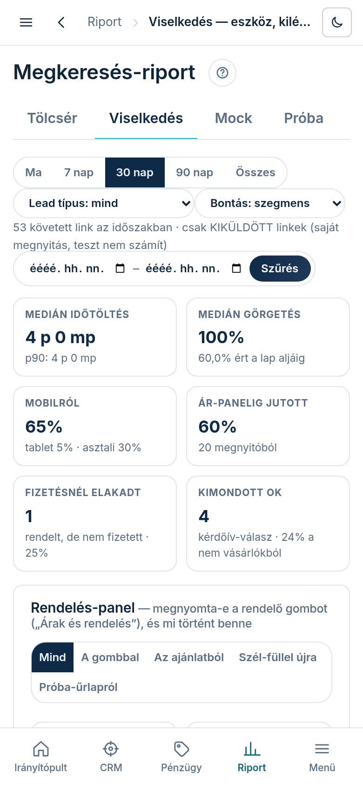
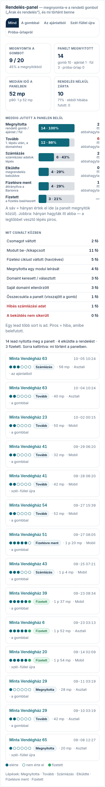

A Riport négy lapon felel a pilot kérdéseire: a **„Tölcsér”** azt mutatja, hol szivárog el a
megkeresés a kiküldéstől a fizetésig, és javul-e hétről hétre; a **„Viselkedés”** azt, hogy
milyen eszközről nézik, hol lépnek ki, és — ahol meg tudjuk mondani — miért; a **„Mock”** azt,
hogy melyik mock-sablon mennyire vonzó; a **„Próba”** azt, hogy mit csinálnak az ingyenes próba
alatt, és hol áll meg a rendelés.

## Hol találod

A bal menüben **„Riport”** → **„Megkeresés-tölcsér”**, **„Viselkedés”**, **„Mock”** vagy
**„Próba”**. A lapok tetején ugyanaz a fülsor: **„Tölcsér”** · **„Viselkedés”** · **„Mock”** ·
**„Próba”**. A szürke **„Pénzügy”** és
**„Tenantok”** fül még nem nyílik — a 2. és a 3. kör ide érkezik, addig csak a helyét mutatja.

## A szűrősor — minden szám erre számolódik

Egy sorban: az **időszak** chipjei (**„Ma”** · 7 · 30 · 90 nap vagy **„Összes”**; a lap a
**„Ma”**-val nyílik), a **„Lead típus”**
legördülő (**„mind”** · nincs honlap · 0 lábnyom · van lábnyom · elavult honlap · ismeretlen) és a
**bontás** legördülő (szegmens · csatorna · eszköz · mock-stílus · küldési óra). A „Lead típus”
csak az adott típusú leadeket hagyja meg: így egyetlen csoport tölcsérét látod önmagában, míg a
szegmens szerinti bontás egymás mellé teszi a típusokat. Ha nem „mind” van kiválasztva, a doboz
kiemelt, és a választás a Viselkedés lapon is érvényes marad. Minden panel a kiválasztott
időszakban KIKÜLDÖTT linkeket nézi — a saját megnyitásod és a teszt nem számít bele, a sor jobb
széle ezt ki is írja. A változás-számok („+3,7 pont”) az előző, ugyanakkora időszakhoz mérnek;
az **„Összes”** mellett ilyen összevetés nincs, ott egy kötőjel áll; a **„Ma”** a tegnapihoz mér.

**Egyedi időszak:** a chipek alatti két dátummezőben add meg a kezdő és az utolsó napot, majd
nyomd meg a **„Szűrés”** gombot. Mindkét nap beleszámít, a mai napnál későbbi nem választható.
Ilyenkor a dátum-doboz kiemelt, mellette ez áll: „Kiküldve 9. 20. – 9. 27. között”. A választás
a lead-típus és a bontás váltásakor, és a Viselkedés lapon is megmarad; egy chipre kattintva
visszatérsz a gyors időszakokhoz. Itt is a link KIKÜLDÉSI napja számít.

## Tölcsér — hét kérdés, hét kártya

Minden kártya egy kérdés, a mérőszám nevével, a nagy értékkel, az ítélettel és a célt jelölő
mérővel:

- **„Megfogja-e a levél?”** — megnyitás / kiküldött (cél 40%).
- **„Visszatér-e?”** — visszatérő / megnyitó (cél 30%).
- **„Belenyúl-e a modulokba?”** — elmélyülő / megnyitó (cél 20%). Elmélyült az, aki modult vagy
  presetet érintett, vagy a lap felénél lejjebb görgetett.
- **„Kipróbálja-e?”** — próba / kiküldött (cél 5%). Hány kiküldött linkről indult kártya nélküli
  ingyenes próba. Csak a ténylegesen elindult próba számít (a félbemaradt indítás nem). A próba a
  rendelés ALTERNATÍVÁJA, nem a lépcső egy foka — ezért ugyanarra a nevezőre (kiküldött) mér, mint a
  következő kártya, hogy a két út egymás mellett olvasható legyen. A próba teljes útja: a Súgóban az
  „Ingyenes próba” téma.
- **„Megrendeli-e?”** — rendelés / kiküldött (cél 4%).
- **„Ki is fizeti?”** — fizetve / rendelés (cél 75%). A „fizetve” a tényleges fizetésből jön,
  nem a lead állapotából.
- **„Gyorsan reagál-e?”** — a küldéstől az első megnyitásig eltelt idő mediánja (cél 24 óra).
  Itt a KISEBB a jobb.

Az ítélet-pill három szava: **„cél felett”** (zöld), **„közelít”** (borostyán), **„cél alatt”**
(piros); adat nélkül **„nincs adat”**. A kártya felső csíkja ugyanezt a színt viseli, így a
lapot görgetve is látod, melyik kérdés áll rosszul. A „közelít” az arányoknál azt jelenti, hogy a cél 70%-át
már hozza; az idő-kártyánál fordítva: legfeljebb 30%-kal lassabb a célnál. A kártya alján a tört
(hány darabból), a változás az előző időszakhoz, és egy hat heti vonal: felfelé megy-e.

**Mediánt nézünk, nem átlagot:** egy 9 napos kivétel az átlagot elvinné; a medián a tipikus
leadet mutatja.

## Visszatérés, bontás, kohorsz, napló

- **„Visszatérés”**: hányan jöttek 1 / 2 / 3 / 4+ alkalommal, és közülük hányan rendeltek
  („rendel: 29%”). Egy sávra kattintva lenyílik a leadek névsora (a legutóbb visszatérő elöl,
  a látogatások számával és az utolsó látogatás idejével, a rendelőknél **„rendelt”** jellel);
  a névre kattintva a lead riportja nyílik (mit csinált a mockon), a **„lead-lap”** link a lead
  adatlapjára visz. Alatta egy mondat az eszkalációs ajánlatról: hánynak jelent meg, hány
  kattintott, hány rendelt, hány vetette el.
- **„Bontás”**: a kiválasztott dimenzió szerint (pl. szegmensenként) a tölcsér hat oszlopa:
  **„Kiküldve”** · **„Megnyitva”** · **„Elmélyült”** · **„Próba”** · **„Rendelés”** · **„Fizetve”**; az
  **„ÖSSZES”** sor az összesítés. Asztali gépen a panel a lap teljes szélességét kapja, így minden
  oszlop látszik; telefonon a táblázat oldalra húzható — az utolsó oszlopok a jobb szélen túl vannak.
  A tölcsér sosem lép vissza: aki fizetett, az a megnyitók között is ott van. A **„Próba”** kivétel:
  az a rendelés melletti másik út, nem lépcsőfok — aki próbázik, nem feltétlenül rendel, és aki már
  fizetett, az nem indíthat próbát. Ha a próbázó a próba után fizetve folytatja, az a folytatás rendelésnek
  számít: ő a **„Próba”**, a **„Rendelés”** és a **„Fizetve”** oszlopban is ott van.
- **„Honnan nyitották”**: melyik üzenet linkjére kattintott a lead — **E-mail**, **SMS**,
  **Viber**, **WhatsApp**, **„Utánkövető levél”** (a nem-nyitóknak küldött egyszeri levél, lásd lent),
  vagy **„Nem eldönthető”**. Felül egy sáv a megnyitó leadek
  megoszlásával, alatta a táblázat: **„Kapta”** (hány lead kapta meg ezen a csatornán a linket),
  **„Megnyitotta innen”** (hány lead nyitotta meg innen), **„Arány”** (a kettő hányadosa; a
  „Nem eldönthető” sorban a megnyitók arányában, csillaggal), és asztali gépen **„Megnyitás”**
  (a látogatások száma) és **„Alap”**. Egy sorra kattintva lenyílik a leadek névsora; a névre
  kattintva a lead riportja nyílik. Egy lead több sorban is lehet: ha előbb az e-mailből, később
  az SMS-ből nyitott, mindkettőben ott van — ezért a sorok összege nagyobb lehet a cím melletti
  megnyitó-számnál; ez nem hiba. A névsorban a **„biztos”** címke azt jelzi, hogy a lead legalább
  egyszer csatorna-jeles linkről jött (telefonon, ahol az „Alap” oszlop nem látszik, ez mutatja a
  biztos megnyitást).
  Az **„Alap”** megmondja, mennyire biztos a szám. **„biztos”**: 2026-11-09 óta a kiküldött link
  végén egy betű jelzi a csatornát (`/?e` e-mail · `/?s` SMS · `/?m` Viber vagy WhatsApp ·
  `/?w` a WhatsApp-utánküldés · `/?f` a nem-nyitó utánkövető levél); a lap ezt olvassa ki, és utána leveszi a címsorból, így egy
  továbbküldött link már nem az eredeti csatornára számít. Viber és WhatsApp között a telefon a
  küldés pillanatában választ, ezért ott a küldés naplója mondja meg, melyik volt.
  **„következtetett”**: régebbi küldés, amelynek linkjén még nem volt jel — ha a megnyitás előtt
  csak egy csatornán ment ki a link, vagy a levelezőprogram (pl. a Gmail-app) adta át, akkor onnan
  jött. **„Nem eldönthető”**: jel nélküli megnyitás, amely előtt több csatornán is kiment ugyanaz a
  link (pl. e-mail és SMS, vagy Viber és a tartalék MMS+SMS) — ez a sor egyre kevesebb lesz, mert
  az új küldések linkje jelet hordoz (jel nélkül csak a begépelt vagy jel nélkül átmásolt cím jön).
- **Az utánkövető levél** (nem-nyitóknak): aki e-mailt kapott, de 14 nappal az utolsó megkeresése után
  (bármely csatornán) egyik linkjét sem nyitotta meg, egyszer kap még egy levelet, ami a terv képével
  indul, és a feladója egy személynév. Nem kapja meg, aki leiratkozott, válaszolt, próbázik, rendelt vagy
  vásárolt, akinek a kiküldését visszavonták, vagy akinek a terve nincs jóváhagyva. Óránként legfeljebb 5,
  naponta alapból legfeljebb 40 megy ki, csak hétköznap 8–17. Ha az éles beállításban nincs megadva a feladó
  neve, egy sem megy ki. Aki ebből a levélből nyitott, az a fenti táblázat „Utánkövető levél” sorában van.
- **„Kohorsz”**: küldési hetek soronként — a hét kiküldöttjeinek hány százaléka nyitott meg 7,
  indított próbát 14 (**„Próba 14 n.”**), rendelt 14, fizetett 30 napon belül. A **„nyitott”** jel azt mondja, hogy a 30 nap még nem
  telt le, tehát a sor még nőhet. A sötétebb cella a magasabb arány. Telefonon ez is húzható.
- **„Pilot-napló”**: naponta a kiküldések (oszlop) és a megnyitások (vonal); az egérrel egy
  napra állva a számok megjelennek. Alatta a jegyzet-űrlap: ① a nap (alapból a mai), ② a
  szöveg (legfeljebb 80 betű), ③ **„Jegyzet hozzáadása”**. A jegyzet függőleges, szaggatott
  jelölőként kerül a diagramra a nap fölött (a felirat 33 betűnél rövidül; az egérrel ráállva a
  teljes szöveg olvasható). Jegyzetet törölni a lapon nem lehet — ezért írj rövidet és
  egyértelműt („Tárgymező csere”).

## Viselkedés — eszköz, kilépés, miért

A lap tetején hat mutató: **„Medián időtöltés”** (és a p90), **„Medián görgetés”** (és hányan
értek a lap aljáig), **„Mobilról”** (tablet és asztali arány mellette), **„Ár-panelig jutott”**,
**„Fizetésnél elakadt”** (rendelt, de nem fizetett) és **„Kimondott ok”** (hány kérdőív-válasz
érkezett). Alattuk teljes szélességben a **„Rendelés-panel”** (lásd lent), utána a panelek:

- **„Eszköz”**: mobil / tablet / asztali — hányan nyitották meg ÉS hány százalékuk fizetett
  („fizet: 10,5%”). Ha a mobil hozza a megnyitásokat, de az asztali a fizetéseket, a mobil
  rendelési folyamat a gyanús — a panel alatti mondat ezt ki is mondja.
- **„Kilépési térkép”**: a mock szekciói sorban (hős, galéria, szobák, …, ár-panel, számlázás,
  fizetés). A halvány sáv: hányan jutottak el idáig; a telített: hányan léptek ki itt. A legtöbb
  kilépés sora piros százalékot kap.
- **„Miért lépett ki”** — két réteg, három nézet. **„Következtetett”**: minden nem vásárló
  megnyitó egy címkét kap a lapon hagyott jelekből (pl. **„Ár-sokk”**: az ár-panel megnyitása
  után 20 másodpercen belül kilépett; **„Számlázási súrlódás”**: a számlázási lépésnél akadt el).
  A „biztos jel” egy konkrét eseményhez kötött, a „közepes jel” időzítésből következtet.
  **„Kimondott”**: a vendég saját válasza az egykérdéses kérdőívből — amíg nincs válasz, a sorok
  üresek. **„Egymás mellett”**: a kettő egymásra vetítve (gép / vendég).
- **„Kalibráció”**: ahol a vendég kimondta az okát, ott mit tippelt a gép — a zöld cella egyezés.
  A tábla alatti mondat megmondja, hány esetből hány egyezett; ha egy sorban sok a nem egyező,
  azon a szabályon kell tekerni. Válasz nélkül a panel ezt írja: még nincs olyan látogatás, ahol
  kimondott ok is lenne.
- **„A vevők elmélyülése”**: **„Gyors vevő”** (6 órán belül fizet az első megnyitástól) és
  **„Mély vevő”** (visszajár, végigpróbálja a modulokat) — két külön vevő, két külön eladási út.
  Ha egyik csoportban sincs vevő, a számok helyén kötőjel áll.
- **„Mikor nyitják”**: nap × óra, Budapest-idő; a legsötétebb cella a csúcs — a küldési ablakot
  ehhez igazítjuk, a mondat alatta megnevezi.
- **„A mikro-kérdőív”**: előnézet — így látja majd a vendég a mock-oldalon az eszkalációs
  ajánlat elvetése után (a gombok itt nem élnek, csak mutatják a kártyát). A válaszok a
  „Kimondott” nézetbe és a kalibrációba folynak be.

## Rendelés-panel — megnyomta-e a gombot, és mi történt benne

Azt mutatja, hogy a megnyitó megnyomta-e az **„Árak és rendelés”** gombot (2026-10-27 előtt „Itt rendelheti meg”), és a rendelés-panelen
belül meddig jutott. Egy sor = egy látogatás, amelyben a panelt megnyitotta; aki visszajött és
újra kinyitotta, több sort ad.

- **Szűrő**: **„Mind”** · **„A gombbal”** · **„Az ajánlatból”** (az eszkalációs ajánlat gombja) ·
  **„Szél-füllel újra”** (a képernyő szélén maradt fül) · **„Próba-űrlapról”** (az ingyenes próba
  űrlapja alatti rendelés-link — külön útként számít). A panel minden száma erre számolódik újra;
  a lap időszak-szűrője ugyanúgy érvényes.
- **Négy mutató**: **„Megnyomta a gombot”** (hány megnyitó nyomta meg a gombot — ezt a szűrő nem
  változtatja), **„Panelt megnyitott”** (a „Mind” alatt gomb · ajánlat · fül · próba-űrlap bontásban),
  **„Medián idő a panelben”** (és a p90) és **„Rendelés nélkül zárta”** (mellette: ebből hány
  futott hibába).
- **„Meddig jutott a panelen belül”**: hat lépcső — **„Megnyitotta”** → **„Tovább”** (a
  domain-választáshoz) → **„Számlázás”** → **„Elküldte”** → **„Fizetésre ment”** (Barion) →
  **„Fizetett”**. Minden sávon a szám és az arány a panelt megnyitók közül; jobbra, hányan hagyták
  ott abba („itt abbahagyta”) — a legtöbbet vesztő lépés száma piros. A „Fizetett” a tényleges
  fizetésből jön, nem a lead állapotából.
- **„Mit csinált közben”**: hány látogatásban váltott csomagot, kapcsolt modult, váltott fizetési
  ciklust, nyitotta meg egy modul leírását, keresett domaint, ellenőrzött saját domaint, vagy
  csukta össze a panelt. A piros sorok hibák: **„Hibás számlázási adat”** és **„A beküldés nem
  sikerült”**.
- **Leadenként**: az összegző mondat alatt a lista, a legfrissebb elöl — Lead · Mikor · Eszköz ·
  Hogyan · Idő a panelben · Lépések (hat pötty: telített = elérte, zöld = fizetett) · Utolsó lépés
  (ha hibába futott és nem ment el a rendelés: piros „· hiba”). **A sorra koppintva kibomlik** a
  panelen belüli idővonal: időpont (Budapest-idő), mit csinált, és a részlet. A lead nevére
  kattintva a lead **Tevékenység** lapja nyílik, ahol minden esemény ugyanezzel a magyar
  felirattal olvasható.

Ha az időszakban senki nem nyitotta meg a panelt, ezt írja: „Ebben az időszakban senki nem nyitotta
meg a rendelés-panelt.” A mérés semmit nem rögzít a saját (`?sajat=1`) megnyitásodnál, a
leiratkozottnál és a már vásárlónál.

## Mock — melyik mock mennyire vonzó

A Mock fülnek saját súgója van: a lapon a cím melletti **?** ikon azt nyitja meg
(„Riport — Mock: melyik mock mennyire vonzó”).

## Próba — mit csinálnak a próba alatt

A Próba fülnek saját súgója van: a lapon a cím melletti **?** ikon azt nyitja meg
(„Riport — Próba: mit csinálnak a próba alatt”).

## Honnan jönnek a számok?

A KIKÜLDÉS pillanatától; a megnyitást és az aktivitást a követett prospect-link méri — a
megnyitás emberi jel (görgetés, érintés vagy 5 másodperc látható fül), ezért a levél-szkennerek
nem számítanak. Kiküldésnek KÉT dolog számít, mindkettő egyformán: ① a rendszerből indított
küldés (a piszkozat-képernyő **„Küldés e-mailben —”** gombja, illetve a mobil páros) — ez magától
bejelöli magát; ② a kézi küldés, amit utólag a lead-lapon a **„Megjelölöm kiküldöttként”**
gombbal jelzel. Ami egyik úton sem került bejelölésre, az itt nem számít bele.
